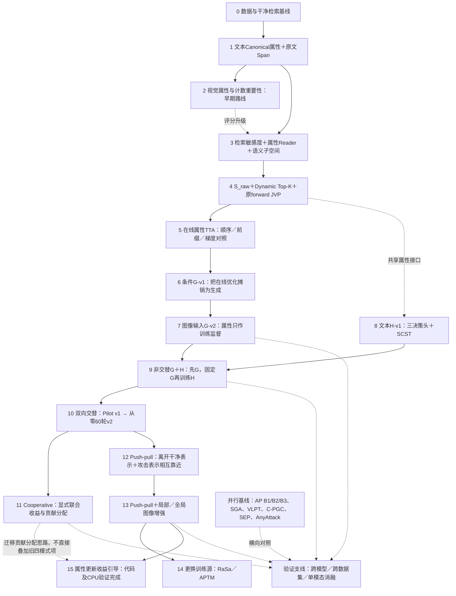

# TBPS Idea：从起点到当前的实验演进简表

截至2026-11-16。按“独立方法/对照设置”梳理：连续Epoch、Checkpoint、Smoke、审计和失败修复记录在所属版本下，不重复计作算法创新。本文不重新训练、不重跑评测。来源为早期阶段文档、各分支正式报告及当前原生训练回执。

## 一、总框架

箭头表示方法设计继承；Cooperative、Push-pull及IRRA图像增强版的正式60轮均从零训练，不表示继承上一版权重。

Cooperative和Push-pull从同一个原交替版分叉；图像增强继承Push-pull。最新属性更新收益版保留Push-pull和增强，借鉴协同信用分配，未把旧四模式相似度项直接加回去。

## 二、主线：每个版本具体增加了什么

| 顺序 | 实验/阶段 | 基础版本 | 本次新增点 | 实际范围/状态 |
|---|---|---|---|---|
| 0 | 数据适配与Clean检索 | 起点 | 统一数据身份、Gallery/Query、同PID多正例与R@K/mAP | 基础评测，不是攻击创新 |
| 1 | 文本属性提取 | 原Caption | 规则提取Canonical属性，保存原文位置映射，支持后续定点编辑 | 已有全量产物 |
| 2 | 图像属性＋Stage03-v1 | 文本属性 | UPAR/C2T-Net预测视觉属性；按跨模态属性匹配和图库计数评分 | 早期全量路线，后续重要性定义被替代 |
| 3 | 检索相关重要性 | 计数重要性 | 从“出现频率”转为“属性变化怎样影响正确图像检索” | 经removal、soft-rank梯度、Attribute Unit多轮探索 |
| 4 | Reader＋语义子空间 | 原token梯度 | 分离属性位置、语义类型与方向，形成可定位的AttributeInstance | 后续G/H复用的属性基础；细分对照见下表 |
| 5 | Dynamic Top-K | 固定/全选属性 | 依据重要性分布有效数自适应确定K；gamma锐化，后续研究去除cap4 | 形成Natural-K路线 |
| 6 | 属性引导在线TTA | 原在线图像攻击 | 把选中属性通过原文本forward JVP变成图像侧监督 | 做过真实机制和调度诊断，非可学习G |
| 7 | 条件G-v1 | 在线属性TTA | 将图像与文本/属性派生条件用于生成器，一次前向生成扰动 | 正式G训练与IRRA Full已有结果 |
| 8 | G-v2 | 条件G-v1 | 推理改为纯图像输入；逐属性K步＋原图联合1步；Local/相邻Retain | Epoch1→2–3→4–10，后续连续至60轮 |
| 9 | H-v1 | 手工文本候选搜索 | Byte Transformer三头选择属性、位置、替换字符；SCST学习编辑策略 | 先小样本/32条SCST再正式训练；早期Joint使用H7 |
| 10 | 非交替G-v2＋H-v1 Joint | 单独G、单独H | 先训练G，再固定G的攻击图库训练H，组合攻击图像和文本 | 三模型四输入模式Full已有正式报告 |
| 11 | G10→G60，H7固定 | 早期非交替Joint | 只延长G训练，比较10/20/30/40/50/60六节点 | 训练量实验，不增加新损失；三模型评测完成 |
| 12 | H对G60适配续训 | 固定H7搭配G60 | 使用G60图库继续训练H至总60轮，并分析H1–10及续训行为 | 训练/内部Validation分析完成；未找到指定非交替G60＋H60正式Full，不能替代G60＋H7 |
| 13 | 双向交替A1/B原型 | 非交替G＋H | A1检验当前G奖励反馈H；B增加H改写后重新定位/JVP指导G | 短数值探针及两轮Smoke；旧严格NOOP审计FAIL保留 |
| 14 | GH-Alternating-v1 | 双向原型 | 完整双模型/Adam/RNG边界、整轮G→新Bank→H；WordBudget1 | 两轮真实Pilot及CPU审计PASS；无正式60轮Full |
| 15 | GH-Alternating-v2 | v1 Pilot | G/H从零交替60轮，恢复原Natural-K；每十轮配对权重及Joint Test | 原60轮与六组IRRA Full最终审计PASS；64MiB修复未重训 |
| 16 | Cooperative | 原交替v2 | 四模式额外联合收益、逐编辑撤销贡献、残余属性加权、同图多描述 | 60轮＋六组IRRA Full完成 |
| 17 | 原Push-pull | 原交替v2 | 共同Train候选上的KL：自身Push＋当前对方攻击表示Pull；替换全局目标/H奖励 | 60轮＋六组IRRA Full完成；保留Local/Retain及H三头 |
| 18 | Push-pull＋图像增强 | 原Push-pull | 原图/局部/全局三视图共享G更新；H奖励聚合当前G三视图库 | IRRA来源60轮＋六组Full完成 |
| 19 | 属性条件更新收益引导 | Push-pull＋增强，借鉴协同分配 | G前瞻属性重加权；H局部反事实位置/字符优势；双向评价器＋GRU历史 | 完整代码、36项CPU测试、双scope预检PASS；尚未GPU训练 |

共享属性接口不等于G/H强制使用相同排序：H推理仍从文本自预测重要性和Natural-K，不读取配对S_raw或图像奖励。

## 三、早期属性表示与优化对照：保留探索分支

以下是主线第3—6步内部的独立研究设置；“新增点”描述当时改动，不代表全部被最终方法采用。

| 实验/设置 | 相对前一设置新增什么 | 去向 |
|---|---|---|
| 配对排名removal | 删除/中和单个属性，观察明确配对图排名变化 | 发现属性耦合与消融粒度问题，保留参考 |
| 保守单槽removal | 依据原文provenance检查独立修改条件，拒绝不可靠消融 | 仍受文本替换可归因性限制 |
| Soft-rank原始token梯度 | 以连续近似排名求梯度，替代逐属性删除重编码 | 发现共享token可能混分 |
| Attribute Unit v1 | 在IRRA中间文本层建立属性support，读取局部检索梯度 | 原型验证 |
| Unit v2 | 单位L2池化support，得到显式属性方向及敏感度 | shared-object方向仍混合 |
| v2.1 Evidence-only | 去掉linked-object注入，仅保留属性证据位置 | 缓解对象支配，保留绑定问题 |
| v3 Fixed Query Reader | 用固定slot/value查询对原文内容做注意力读取 | 读取不够稳定 |
| v3.1 Value-token Query | 查询由EOT改为canonical value token表示 | 部分改善，转向可学习Reader |
| v4 Learned Slot Reader | 学习slot query及value/null分类器，IRRA冻结 | 后续Reader基础 |
| v4.1 Low-rank Projection | 增加每槽正交低秩子空间及分类器 | 检验属性方向分离 |
| v4.2-B 随机独立子空间 | 固定各槽随机basis，只训练分类器 | 区分随机几何和监督学习贡献 |
| v4.2-C 共享随机子空间 | 各槽共用一个随机basis | 排除槽独立几何的混淆 |
| v4.2-D 共享初始化后独立学习 | 从相同basis起点分别训练 | 控制初始化，观察学习本身作用 |
| v4.3 Value-specific方向 | 由分类器权重构造值特定方向，替代一般梯度方向 | 独立方向对照，不直接等于最终方法 |
| v5 Contextual Subspace | 使用属性值中心张成语义子空间，比较Euclidean/tangent/同rank random | 语义子空间路线 |
| v5.1 Controlled Selectivity | 固定属性对，比较目标变化和非目标泄漏 | 诊断，未增加攻击目标 |
| v5.2 Leakage/Binding诊断 | 拆解上下衣、颜色/类型和绑定混淆 | 促成属性本体重构 |
| v5.3 Factorized Ontology | 分开衣物类型、长度等轴与region | 属性表示结构调整 |
| v5.4 Semantic-axis审计 | 统一语义轴和区域归属，检查覆盖/冲突 | 固定后续属性空间 |
| v5.5 AttributeInstance | 统一canonical/type/region/原Span与resolved状态 | G/H接口基础 |
| Stage05回调调度 | 把属性集合及原文映射接到图像→文本回调 | 调度/接口实现，不等同可学习双向更新 |
| Stage06早期训练框架 | 增加硬预算、CLIP/排名训练接口PoC | 后续由真实IRRA G训练接线替代 |
| 早期联合攻击500-query PoC | 逐Query修改配对图库项及已知ID文本候选搜索 | 开发诊断；后改为固定共享图库与学习式H |
| Step5.1 S_raw | 在约束语义子空间内计算检索敏感度 | 正式属性评分基础 |
| Step6.1 Power Top-K | 比较gamma=1/1.5/2/3，锐化重要性分布 | 后续gamma3，不改变原分数排序 |
| TTA NEW/RAW/NONE | 比较原forward JVP、原文属性表示和caption-only监督 | 引导方式对照 |
| SEQUENTIAL vs PREFIX | 只优化当前属性，改为保留已攻击属性前缀 | 针对多属性遗忘 |
| CAPPED-4 vs Natural-K | 保持共同前4轮，额外执行自然K后续轮 | 属性数量/计算预算研究 |
| Score-weighted/priority projection | 使用S加权历史目标，并处理新旧属性梯度冲突 | 优化方向对照 |
| Fast历史梯度聚合 | 尝试把历史多个梯度合为一次计算 | 严格行为等价失败，未作为无损替代 |
| Batched per-attribute VJP | 批量求各属性独立梯度 | 行为等价门槛失败，未作无损替代 |
| Aggregated-objective priority | 明确改用聚合目标，而非声称等价加速 | 小规模/后续诊断，未冻结为最终G训练损失 |
| Top-K/Random-K/Bottom-K | 同候选、同K、同优化器比较选择价值 | 属性选择消融，不能用早期500-query配对替换PoC代替正式共享图库结论 |
| PID/图库身份诊断 | 排查正例映射与共享图库协议 | 评测有效性修正，不是新攻击算法 |

## 四、验证支线：改变训练量、模型或数据集

| 实验 | 相对原设置改变什么 | 核实结果/边界 |
|---|---|---|
| G-v2六节点Image-only/Joint | 只改变G训练轮次；Joint中H7固定 | 三模型六节点正式结果已有报告 |
| 非交替Joint三模型四模式 | 固定IRRA来源G/H，组合Clean、Image-only、Text-only、Joint并使用原生评分 | 正式Full完成 |
| 联合攻击消融框架 | 增加替代文本策略、多seed及四模式对照 | 有代码/CPU阶段报告；本文不把准备态直接记为新增Full |
| G-v2跨数据集 | CUHK训练G60冻结，迁移至RSTP/ICFG及各自IRRA | 两目标Full及CPU审计PASS；初版审计FAIL另保留 |
| G60＋H7跨数据集 | 在上述迁移基础上加入固定H7文本攻击，检查四模式 | 两目标正式Full及CPU审计PASS |
| Cooperative → RaSa/APTM | IRRA训练G60/H60不变，目标换模型 | 两组迁移Full及CPU审计PASS |
| 原Push-pull → RaSa/APTM | 同上，更换来源方法 | 两组迁移Full及CPU审计PASS |
| 增强Push-pull → RaSa/APTM | 同上，更换来源方法 | 两组迁移Full及CPU审计PASS |
| RaSa源增强Push-pull | 训练代理由IRRA改RaSa，重建原生Reader/basis/JVP/奖励库 | 准备后Smoke OOM停止；无正式Round1权重 |
| APTM源增强Push-pull | 训练代理由IRRA改APTM，同样重建原生属性监督 | 已完成60轮，60份Round CPU审计PASS；六组配对Checkpoint齐 |
| APTM源白盒及迁移 | 固定各节点APTM训练权重，评APTM/IRRA/RaSa | 仅APTM Round10 Full审计PASS；Round20及两迁移工作进程已失败停止，不能记作六节点全部完成 |

原生训练最后一项核验快照：2026-11-16 12:50（Asia/Shanghai）。APTM正式训练G更新511560、H访问122880、H更新122220；其G更新数与IRRA来源不同，来源属性选择不同，不能写成等G更新预算。

## 五、并行Baseline：适配变化与正式创新主线分开

| Baseline/对照 | 相对上一设置变化 | 已核实范围 |
|---|---|---|
| AP B1 | Duke来源本地复现G迁到CUHK/IRRA | 500-query及Full完成；不是已核实作者发布G |
| AP B2 | AP训练数据改CUHK，沿用原语义分支 | 正式训练及Full完成 |
| AP B3 | 再把图像训练代理换IRRA | 正式Full及后续三模型评测完成；无真实Caption监督 |
| SGA-TBPS White-box | 借鉴集合/多尺度图像攻击，分别访问各目标梯度 | 三模型Image-only Full完成；保留为白盒适配，不冒充原SGA |
| 官方SGA/IRRA Source | 调用固定官方完整图文交替攻击流程，统一IRRA来源后迁移 | 三目标正式Full及CPU审计PASS；与前一白盒实验分开 |
| VLPTAttack（DRA） | 另一个官方图文攻击流程，IRRA Source及三目标、四模式评测 | 正式Full及CPU审计PASS；单模态行为同一Joint产物的组合 |
| C-PGC | 使用已有UAP及其文本攻击，扩展三数据集/IRRA-RaSa | 已有正式结果；CUHK新增单模态消融PASS；三数据集模态扩展另有执行记录 |
| SEP原协议/早期Source-only | 先接线原生成流程，再研究Source-only伪PID、PID计算与吞吐 | 早期长任务停止及两次Text-only Full FAIL保留 |
| SEP WordBudget1 | 固定Source-only条件，搜索与输出限制为最多替换1词 | 三数据集×两目标Text-only流水线SUCCESS；该预算不同于Idea每词1字符 |
| AnyAttack 16/255 | 官方现成Decoder，不做TBPS微调 | 三模型Image-only Full完成；补充预算实验 |
| AnyAttack 8/255 | 只修正到项目图像预算，保留现成Decoder及原文 | 三模型Full及CPU审计PASS；没有额外文本分支 |
| R²TUA表1协议审查 | 核对引用来源与权限/预算/评测环境 | 文献参考/协议审计，不记作本地重新跑过R²TUA |

上述设置的攻击面、预算和目标权限不同，不把它们连接为同一算法的连续升级。

## 六、工程修复和未运行方案

| 记录 | 实际作用 |
|---|---|
| G-v2 Full Tensor Storage修复 | 保存/读取真正clone，避免view带上整块Storage；不改变算法 |
| 图像8/255浮点投影修复 | FP64计算数学端点再FP32向内舍入；不加预算容差 |
| 原60轮64MiB Ledger审计恢复 | 严格SHA后受控解析原账本；训练/Checkpoint不重跑、不重写 |
| 跨模型v1→v2接线修复 | 恢复目标原生编码/融合/完整排名及来源验证；不重新训练来源G/H |
| 原生RaSa/APTM发布与内存修复 | 补provenance、CPU Reader/无用组件暂存/激活重计算；旧FAIL保留 |
| C-PGC/SEP加载、PID聚合、吞吐优化 | 属于兼容或等价性能修复，另记真实失败/恢复Attempt，不算攻击创新 |
| A*方向搜索、全属性链反传、多字符改一个词 | 属于讨论方向，未作为已完成实验列入 |
| Cooperative＋Push的直接合并讨论 | 曾讨论目标竞争；最后落到已实现的属性更新收益引导版，不另算一个已训练版本 |

历史表格中的“g-h-g v1（60轮）”曾对应原GH-Alternating-v2，不能再重复当成一个新60轮方法。非交替G60/H60、非交替G60/H7、交替Round60 G/H也必须按来源区分。

## 七、目前的研究落点

最早研究“选哪些属性”，随后研究“怎样把属性变成扰动”，再研究“怎样让G/H交替利用对方”，目前推进到“属性怎样指导双方内部更新，使对方下一步更有效”。

最新版本内部是属性前瞻重加权、反事实编辑优势和历史响应；攻击样本之间保留Push-pull，并用多视图增强检验稳定性。当前证据是代码及CPU验收，没有该新版的GPU攻击效果。

主要来源：本地docs/stages阶段报告；服务器各方法docs/framework/results；原生增强训练每轮cpu_audit/completed/report.json及Checkpoint目录。主要引用文件的身份索引见[来源索引](PROJECT_EXPERIMENT_EVOLUTION_SOURCES.json)。
