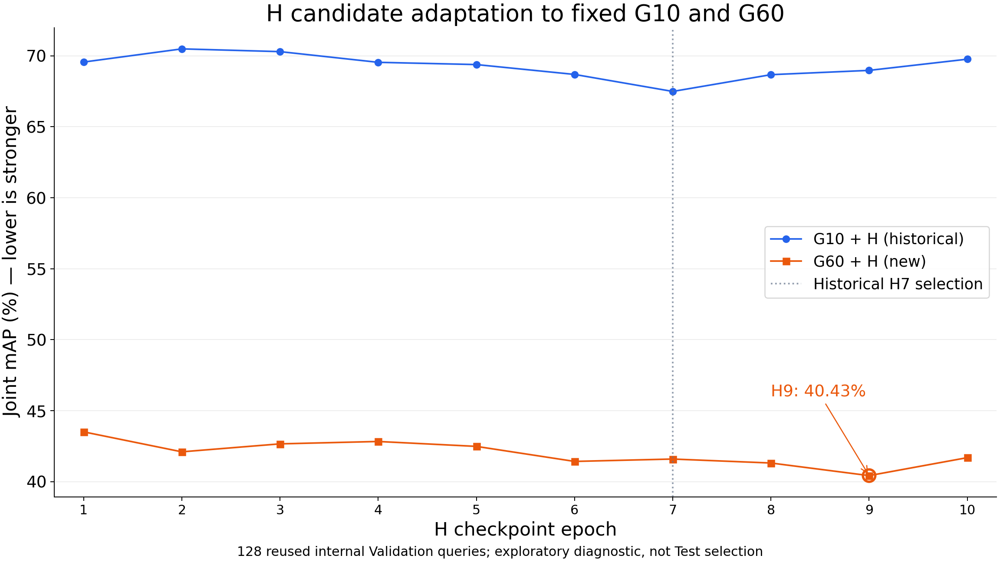
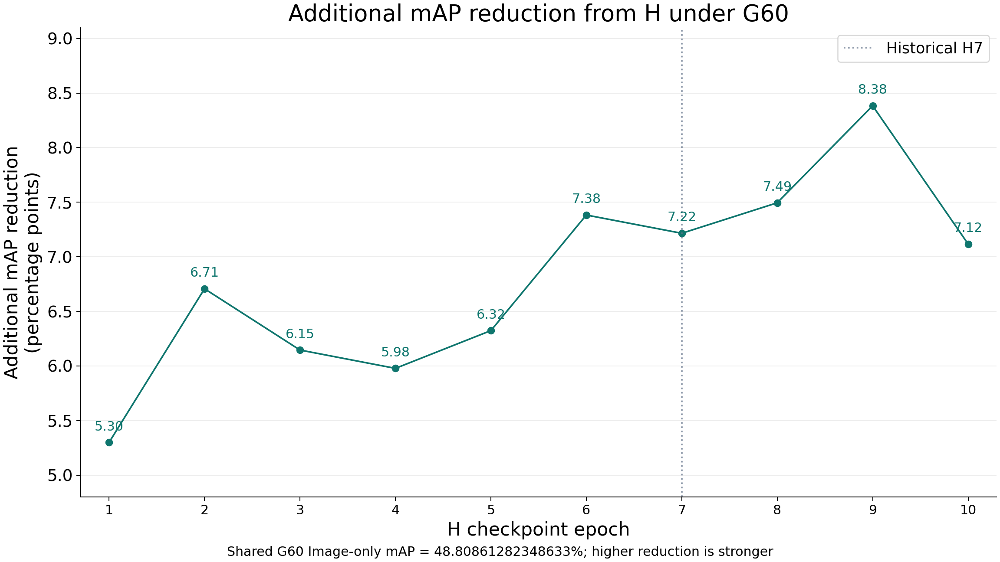
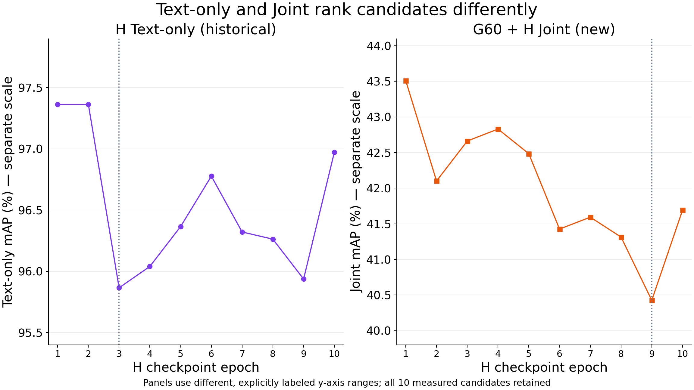

# G60 × H1–H10内部Validation适配性诊断

日期：2026-10-21（Asia/Shanghai）。基准be30206f3d6170c06cb34716e3b111f52945c0af；
冻结执行Commit：048fafc15040f90f7152f78a3b4d48728bd300ac。
独立分支codex/g60-h-validation；工作树/home/lzf/ldx/projects/idea-test-tbps-g60-h-validation-20261021。

**结论：本次Validation PASS。G60下H9的Joint mAP最低（40.425479888916016%），H7排名第4（41.59333801269531%）。**
两者相差1.1678581237792969个百分点；H9相对G60 Image-only额外降低8.383132934570312个百分点。
历史G10下H7第一，G60下第一变为H9。正式H7 Selection保持不变。

## 范围、协议和来源

这是重复使用原128内部Validation的探索性适配诊断；G60已先前完成Test消融，因此不能称全新独立验证、
Test最优H选择或跨模型普遍结论。没有训练、正式Test计算或RaSa/APTM新评估。
仅读取官方annotation确认成员和Test PID隔离；没有使用Test反馈比较H候选。

128张原图/128条原Caption保持历史H Validation顺序、首Caption和身份，121个Validation PID；
与2048 Train（1861 PID）及官方Test PID交集均为0。固定保留全部Query及1条不可编辑NOOP，不按攻击收益筛选。
原文件夹名中的test_query不作为split判据：实际annotation split=train、内部role=validation。

原图严格调用冻结pixels_from_pil：PIL RGB、bilinear Resize384×128、ToTensor。
冻结G60使用原ImageOnlyGenerator和generate_once，单图单次；Adv FP32直接进入IRRA normalize_pixels，
没有PIL/JPEG重新量化。相对原图严格L∞≤8/255，像素[0,1]。
IRRA FP32/math/no_tf32、batch1；512维L2归一化图像/文本特征。
评分原样采用历史Validation的CPU FP32 text @ gallery.T和官方utils/metrics.py::rank(max_rank=10,get_mAP=True)；
全部同PID正例，无camera过滤。未另写排序、mAP或Recall算法。

H1–H10文本及动作由原正式候选Validation保存；只读验证Checkpoint SHA、协议、128条身份/顺序、
原文/对抗UTF-8、Unicode动作、Tokenizer审计、特征文件SHA、FP32/维度/归一化及完成回执后复用。
复用文本内容不等于复用旧Joint分数：旧G10指标只读引用，新的G60 Image-only和10组Joint均实际计算。
Clean及Text-only等历史四项原精度指标完整保留在[metrics_raw.csv](metrics_raw.csv)，不重新排名。

## 验证状态

| 检查 | 实际结论 |
| --- | --- |
| CPU来源Preflight | G60_H_CPU_PREFLIGHT_PASS；6564个来源SHA/stat，109个固定producer |
| CPU回归 | 162个不同用例分日志核验通过；见下文异常与恢复说明 |
| 固定前2张Smoke | PREFIX_SMOKE_PASS、PREFIX_CPU_AUDIT_PASS，已计入128总量 |
| G60图像生成 | 128/128；加载1次，started/completed=128/128 |
| IRRA对抗图像编码 | 128/128；加载1次 |
| H加载/前向、新文本编码 | 全部0 |
| Backward/Optimizer/JVP | 全部0 |
| 参数和buffers | G与IRRA前后SHA exact，eval、requires_grad=False、无参数梯度 |
| 新评分 | Image-only 1组 + Joint 10组；均128×128完整矩阵 |
| 独立CPU审计 | G60_H_VALIDATION_CPU_AUDIT_PASS，exit0，271个不可变产物 |
| 历史保护 | 150417个历史文件size/mtime/inode不变；消费来源6564项SHA/stat不变 |
| 缺项/残留 | 无pending、孤立Claim、FAIL或缺少单元；128 Claim逐一绑定128图像证明 |

前2张生成、编码、读回、CPU像素/特征审计及冻结检查通过后才继续第3张，保留前2张，不额外生成Smoke。
最终审计在CUDA不可见的独立CPU进程中重新核验本次11组小矩阵和官方指标，未调用旧历史审计入口或Full。
[CPU Preflight](CPU_PREFLIGHT.json)、[CPU审计](CPU_AUDIT.json)、[128图证明索引](IMAGE_INDEX.json)、
[来源/实际执行/SHA证据](SOURCE_EVIDENCE.json)、[CPU测试证据](CPU_TEST_EVIDENCE.json)。

### 中断前CPU失败与恢复

原tests.log记录4个Fixture命名空间失败；只修新测试临时目录命名，ArtifactStore原规则未变。
中断前tests_regression.log实际已结束：158通过、1失败，原日志完整保留。
该失败在旧test_gv2_sweep.py:199尝试从绑定旧工作树绝对路径的配置移除新树路径时KeyError，
尚未进入被测来源拒绝函数。没有删除断言或改旧配置：只在其绑定原冻结工作树执行此用例一次，PASS/exit0。
原已通过的129个公共用例不重复；新/受影响32个用例完整PASS/exit0（含来源缺项、非法SHA、
前2张审计失败即停止、128顺序、紧凑Storage、严格预算、冻结和禁止优化）。
因此合计162个不同用例得到通过证据，不声称原失败命令当时成功。

## 主表：H候选对G10/G60的适配

所有mAP单位为百分数。额外下降为G60 Image-only mAP − G60 Joint mAP，单位为百分点，允许按原精度计算后展示两位。
每个H共用同一个G60 Gallery；Image-only 48.80861282348633%不是重复计算的10个不同控制组。

| H Epoch | G10 Joint mAP (%) | G60 Joint mAP (%) | G60 Image-only mAP (%) | G60额外下降 (pp) | Text-only mAP (%) |
| --- | --- | --- | --- | --- | --- |
| 1 | 69.56 | 43.51 | 48.81 | 5.30 | 97.36 |
| 2 | 70.49 | 42.10 | 48.81 | 6.71 | 97.36 |
| 3 | 70.30 | 42.66 | 48.81 | 6.15 | 95.87 |
| 4 | 69.54 | 42.83 | 48.81 | 5.98 | 96.04 |
| 5 | 69.39 | 42.48 | 48.81 | 6.32 | 96.37 |
| 6 | 68.69 | 41.43 | 48.81 | 7.38 | 96.78 |
| 7 | 67.49 | 41.59 | 48.81 | 7.22 | 96.32 |
| 8 | 68.67 | 41.31 | 48.81 | 7.49 | 96.26 |
| 9 | 68.98 | 40.43 | 48.81 | 8.38 | 95.94 |
| 10 | 69.77 | 41.69 | 48.81 | 7.12 | 96.97 |

[主表原精度CSV](comparison_raw.csv) · [两位小数CSV](comparison_2dp.csv)。

### G60 Joint完整四项指标

| H Epoch | R@1 (%) | R@5 (%) | R@10 (%) | mAP (%) |
| --- | --- | --- | --- | --- |
| 1 | 34.38 | 54.69 | 60.94 | 43.51 |
| 2 | 32.81 | 53.91 | 60.16 | 42.10 |
| 3 | 32.81 | 53.91 | 60.94 | 42.66 |
| 4 | 34.38 | 53.12 | 60.94 | 42.83 |
| 5 | 32.81 | 53.12 | 60.16 | 42.48 |
| 6 | 32.03 | 53.12 | 57.81 | 41.43 |
| 7 | 32.81 | 53.12 | 59.38 | 41.59 |
| 8 | 33.59 | 52.34 | 59.38 | 41.31 |
| 9 | 32.81 | 51.56 | 59.38 | 40.43 |
| 10 | 32.81 | 53.91 | 59.38 | 41.69 |

G60 Image-only：R@1=39.84375%、R@5=59.375%、R@10=65.625%、mAP=48.80861282348633%。
历史Clean四指标100%，G10 Image-only mAP=77.11044311523438%；128规模/首Caption的基线不能直接与3074 Gallery Full Clean比较。

### 全10候选排名

按Joint mAP升序，仅作已完成实验描述：

| H Epoch | G10 Joint mAP排名 | G60 Joint mAP排名 |
| --- | --- | --- |
| 1 | 7 | 10 |
| 2 | 10 | 6 |
| 3 | 9 | 8 |
| 4 | 6 | 9 |
| 5 | 5 | 7 |
| 6 | 3 | 3 |
| 7 | 1 | 4 |
| 8 | 2 | 2 |
| 9 | 4 | 1 |
| 10 | 8 | 5 |

G10顺序：H7→H8→H6→H9→H5→H4→H1→H10→H3→H2。
G60顺序：H9→H8→H6→H7→H10→H2→H5→H3→H4→H1。
排名变化不依据任何官方Test候选比较，历史Selection未覆盖。

## 研究分析

**Q1：H7仍最低吗？** 否。G60下H9最低，H8第二；H9比H7低1.167858个百分点，
比第二名H8低0.888592个百分点。H7从G10第1变为G60第4。
所有10组Joint mAP均低于同一G60 Image-only：额外下降范围5.299969–8.383133个百分点。
H9的R@1为32.8125%，与H7相同；R@1最低为H6的32.03125%，所以不能称H9在四项指标均最强。

**Q2：候选排序是否改变？** 是。H9由第4变为第1，H7由第1变为第4；
H8/H6分别保持第2/3，其他候选也有重排。直接观察支持“固定不同G时，H候选的联合表现排序会变”，
不证明存在某种已验证的协同机制或分布变化因果。

**Q3：H Epoch越多越强吗？** 不是单调关系。H1→H10的G60 Joint mAP由43.508644降至41.691406%，
但H2→H3→H4逐步回升，H6→H7回升，H9→H10又回升1.265926个百分点。
十点mAP范围3.083164个百分点；不能从单一最低节点宣称收敛、训练不足或统计显著。

**Q4：Text-only能否替代Joint选择？** 不能。历史H3 Text-only最低（95.86588287353516%），
却在G10 Joint排第9、G60 Joint排第8（42.66276550292969%）。
H9 Text-only排第2（95.9375%）而G60 Joint排第1；文本单独表现与联合排序不一致。
历史G10偏好的H7与G60偏好的H9不同，是组合条件下的直接数值观察。

**Q5：是否应立即训练H60？** 当前证据不足以支持直接扩展到60 Epoch。
较晚H8/H9在G60下优于H7，提示值得研究适配差异；H10没有继续改善，单纯延长训练未被证明有效。
优先审查重复Validation带来的选择偏差，再预先固定独立确认协议及资源预算；
是否开展H训练长度实验、是否改变奖励，应由新的授权和实验设计决定，本轮不提出已获验证的新Loss。
本次仅128 Query、121 PID、单次比较、单训练轨迹，无多seed或置信区间，
无法声称H9跨模型普遍更强或正式优于H7。正式H7继续冻结。

## 曲线

横坐标为实际H Epoch1–10，只连实测节点；不同面板的尺度有明确标注，无插值或平滑。
[绘图原数据](comparison_raw.csv)；[可复现CPU绘图脚本](plot_figures.py)。

[SVG](joint_map_g10_g60.svg)

[SVG](joint_extra_drop_g60.svg)

[SVG](text_only_vs_g60_joint.svg)

## 资源与实际执行

2026-10-21 22:15:13 +08:00启动受控命令，完整命令约56.201秒（含CPU来源准备）。
GPU/物化/评分执行段39.318593秒；不是纯神经前向时间，也不用于推算H训练成本。
GPU peak allocated=797.614258 MiB、reserved=866.000000 MiB；进程Peak RSS=2342.359375 MiB。
新增产物956个文件、233862038字节（约223MiB）；大Tensor、像素、权重和原日志不提交Git。

启动共享GPU快照：RTX4090空闲18431MiB、利用率94%，外部PID1402779占用5612MiB；
RAM可用121404039168字节、磁盘可用6189813583872字节。采用已授权shared_observe_only，
利用率只记录，外部任务未终止/暂停/修改；共享负载可能影响时间，不能把耗时当独占GPU性能。
运行结束自身GPU Worker已退出。只有一个正式validation_v1 Attempt，没有GPU失败或重试。

G状态SHA：5d48caab6a891a1afd3aaaa6f3594eb5f860ccd7b6090708d289224e6c819e47。
IRRA状态SHA：f72a69c88229d38caabd5c47f6647adc1fd9f3b444218ebcc9c8e1eb723a078f。
模型参数、buffers、无梯度和eval状态均通过；原H7 Selection SHA保持。

## 来源与不可变证据

| 来源 | 绝对路径 | SHA-256 |
| --- | --- | --- |
| G60 | /home/lzf/ldx/outputs/tbps-framework-gv2-epoch60-ablation/train/checkpoints/epoch_0060/checkpoint.pt | 9148a6ac06178b2eb474194ef6892c50182c5623b4e88bdcf88faa358aa46049 |
| IRRA | /home/lzf/Attack/IRRA/logs/CUHK-PEDES/best.pth | 9ff6209551ea8d6ee80396214a2534301fba5d58fa2c5a1875a338f61b295009 |
| 旧H7 Selection | /home/lzf/ldx/projects/idea-TBPS-test1-github-sync-20261014/prototypes/attribute_text_policy_h_v1_20261015/outputs/formal_v1/selections/30f573098d28b6af6afe146330823986f724378fc7bd4df9d257fdd2c6f20dd1.json | 584e4ba2afc7b17fea3bdfb8501716498b84731fa216558daa2e8e4bb353f757 |
| 新完成摘要 | /home/lzf/ldx/outputs/tbps-framework-g60-h-validation/validation_v1/completed/summary.json | 0aaa51df2b57fb34578cb448cc23a0e7521f347b0b9dd6424ef8584198fe28f9 |
| 新CPU审计 | /home/lzf/ldx/outputs/tbps-framework-g60-h-validation/audit_v1/result/report.json | c6664b04a9178331314370dc2f6b931f989fc0dd9cd5060fd69c96bd02694812 |

原128 Gallery/原文/十候选缓存关系、原生IRRA ModelSpace、Tokenizer及预处理摘要见SOURCE_EVIDENCE.json。
新Gallery内容SHA：ae7bce28e383745487812f9fbf0af6bd44cd44312936c905cb27f5df2871a23d。
原始完整来源索引保留在服务器protocol/preflight.json，Git中只提交轻量索引及SHA。
不将历史G10特征改签为G60，也不把IRRA特征用于其他模型。

### H候选权重身份

所有原Checkpoint只读哈希，H模型未加载。

| H Epoch | Checkpoint SHA-256 | visit |
| --- | --- | --- |
| 1 | eb4cbbeaf4f5aa71591fbda03bee552766aca69241831b370c56af5f803f7783 | 2048 |
| 2 | adad480049a3b223c0a94a3c56dce15b6bfbeba7863fe562e2b08877a12e7f99 | 4096 |
| 3 | 0d3f8482cf93d9ac301d8fdab8c4725ee5fd9197974fd443cd150908eb79eb5d | 6144 |
| 4 | de8de5320d87261aa6fc4ef73ca4340048506a21eccab315a4cb0afdc57cc3ac | 8192 |
| 5 | 107a021305a748766f24b93f2e25f99587a77e295c964c700de98b1e76ec30eb | 10240 |
| 6 | 14a83a877009d2b6b28d5b379bb75f64b5c653f4cfd36aadcbe0006237139734 | 12288 |
| 7 | 487f3061b6cba2ddabccdd49745a7b99c8c549f4541781b8814b299ef5f279df | 14336 |
| 8 | 6fcb655e1ef799348e7a7d22128fa75c12fcf89acc4763c6ce0f5cf4ac38fc6b | 16384 |
| 9 | ca3f47ca4d9fb9da82a44b0252251539aa48feaac49dee8328dbd609fd026a79 | 18432 |
| 10 | 4ae964d51ea94840de71d9597d90a2234a36104e5d649cfee96577f59f94bacd | 20480 |

### 完整四指标汇总（历史引用与新增结果区分）

| H Epoch | Group | R@1 (%) | R@5 (%) | R@10 (%) | mAP (%) |
| --- | --- | --- | --- | --- | --- |
| 1 | G10 + H Joint | 57.03 | 85.94 | 89.06 | 69.56 |
| 1 | G60 + H Joint | 34.38 | 54.69 | 60.94 | 43.51 |
| 1 | H Text-only | 95.31 | 99.22 | 99.22 | 97.36 |
| 2 | G10 + H Joint | 57.81 | 85.16 | 90.62 | 70.49 |
| 2 | G60 + H Joint | 32.81 | 53.91 | 60.16 | 42.10 |
| 2 | H Text-only | 95.31 | 99.22 | 99.22 | 97.36 |
| 3 | G10 + H Joint | 57.81 | 84.38 | 88.28 | 70.30 |
| 3 | G60 + H Joint | 32.81 | 53.91 | 60.94 | 42.66 |
| 3 | H Text-only | 92.97 | 99.22 | 99.22 | 95.87 |
| 4 | G10 + H Joint | 57.81 | 82.81 | 87.50 | 69.54 |
| 4 | G60 + H Joint | 34.38 | 53.12 | 60.94 | 42.83 |
| 4 | H Text-only | 93.75 | 99.22 | 99.22 | 96.04 |
| 5 | G10 + H Joint | 57.81 | 82.03 | 88.28 | 69.39 |
| 5 | G60 + H Joint | 32.81 | 53.12 | 60.16 | 42.48 |
| 5 | H Text-only | 93.75 | 99.22 | 99.22 | 96.37 |
| 6 | G10 + H Joint | 56.25 | 83.59 | 89.06 | 68.69 |
| 6 | G60 + H Joint | 32.03 | 53.12 | 57.81 | 41.43 |
| 6 | H Text-only | 94.53 | 99.22 | 99.22 | 96.78 |
| 7 | G10 + H Joint | 56.25 | 82.03 | 86.72 | 67.49 |
| 7 | G60 + H Joint | 32.81 | 53.12 | 59.38 | 41.59 |
| 7 | H Text-only | 94.53 | 99.22 | 99.22 | 96.32 |
| 8 | G10 + H Joint | 56.25 | 82.03 | 88.28 | 68.67 |
| 8 | G60 + H Joint | 33.59 | 52.34 | 59.38 | 41.31 |
| 8 | H Text-only | 94.53 | 99.22 | 99.22 | 96.26 |
| 9 | G10 + H Joint | 56.25 | 82.81 | 86.72 | 68.98 |
| 9 | G60 + H Joint | 32.81 | 51.56 | 59.38 | 40.43 |
| 9 | H Text-only | 93.75 | 99.22 | 99.22 | 95.94 |
| 10 | G10 + H Joint | 57.81 | 83.59 | 88.28 | 69.77 |
| 10 | G60 + H Joint | 32.81 | 53.91 | 59.38 | 41.69 |
| 10 | H Text-only | 95.31 | 99.22 | 99.22 | 96.97 |
| — | Clean | 100.00 | 100.00 | 100.00 | 100.00 |
| — | G10 Image-only | 67.19 | 89.06 | 96.09 | 77.11 |
| — | G60 Image-only | 39.84 | 59.38 | 65.62 | 48.81 |

[33条原精度记录](metrics_raw.csv)包含G10 Joint10、G60 Joint10、Text-only10及3个固定控制；
[两位小数版本](metrics_2dp.csv)、[排名CSV](ranks.csv)、[统计JSON](statistics.json)。

## 结束边界

本次为G60×已有H候选适配诊断PASS，不是正式新H Selection、官方Test、跨模型确认或H60训练结论。
没有重跑历史GPU Smoke、G60 Full、G/H训练或旧CPU审计。
不自动训练H60，不加入交互Loss，不运行H9官方Test；后续由用户审查决定。
