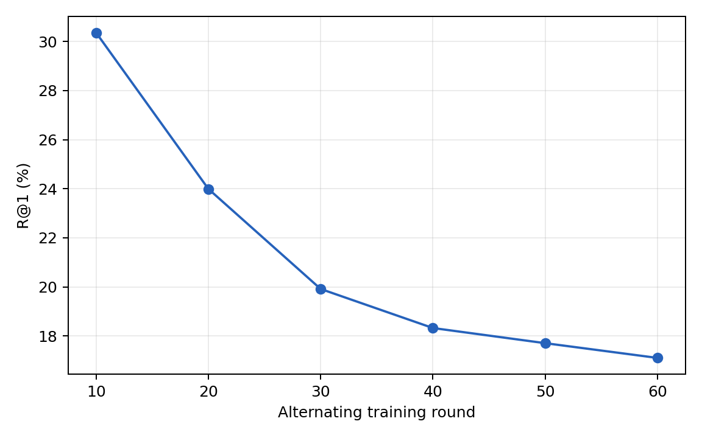
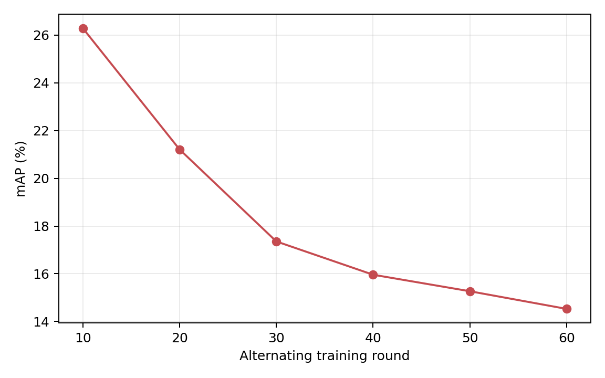

# GH-Alternating-v2：60轮训练后审计恢复与六组Joint正式Test

**原60轮CPU审计PASS；六组完整Joint Test及独立CPU审计全部PASS。没有重新训练。**

训练仅原Attempt：484080次G更新、122880次H访问、122220次H更新，训练79478.77秒。原Supervisor的64MiB FAIL、started.json和日志保持。恢复工具及执行身份独立；原158份生产源码、496份依赖和冻结配置保持SHA。

账本总3890547998字节；第2轮首次超64MiB，超限轮为2/3/4/5/7/9/10。独立读取器在原Manifest和SHA验证后逐项完整严格解析G/H/conditions，检查重复键、UTF-8、非有限值、尾随/截断、字段结构；单项4MiB、块64Ki字符，没有修改全局read_json。

独立CPU训练审计覆盖60轮、全部2048×60数据：状态/完整父态声明链、每样本K+1、当前H条件、原S_raw/选择、原JVP回执、冻结隔离、当前RewardBank和六组权重身份。审计耗时157.25秒，进程峰值RSS 558.88MiB；新模型前向/更新/JVP/CUDA均0。

证据边界：第1–59轮原始Bank、完整状态和rollout按原流水线滚动策略已退休，逐轮核对不可变账本、退休Manifest、连续状态摘要和训练预算记录；这些轮次不能宣称重新检查已不存在的原始Tensor。第60轮保留的完整Bank/条件/rollout逐项独立读取。全部历史H sampled/greedy输出重算原候选合法性与Natural-K，回放Unicode编辑；每合法原词位≤1字符，无WordBudget1。

恢复工具第一版新增逐步H检查混用了原生state_sha与轮边界tree_sha，13秒停止、未进行Test；其FAIL和日志完整保留。第二版独立控制身份修正摘要域，使用冻结原state_sha验证整条H更新链，并在初始/六Checkpoint/最新状态同时桥接两种摘要，没有跳过连续性检查。

六组各自严格加载原G10/H10至G60/H60；每组独立生成3074 Gallery/6156 Query。CUHK-PEDES × IRRA、Joint-only、原生完整Gallery全部同PID正例检索、FP32、L∞≤8/255；无Clean/单模态/额外模型数据集，也不将Test结果反馈训练或选点。

| Round | R@1 | R@5 | R@10 | mAP |
|---:|---:|---:|---:|---:|
| 10 | 30.36 | 50.55 | 59.47 | 26.29 |
| 20 | 23.99 | 42.76 | 51.56 | 21.21 |
| 30 | 19.92 | 36.18 | 44.80 | 17.35 |
| 40 | 18.32 | 34.24 | 41.78 | 15.96 |
| 50 | 17.71 | 32.46 | 40.07 | 15.27 |
| 60 | 17.11 | 31.24 | 38.92 | 14.53 |

单位%；越低攻击越有效。原精度见METRICS.csv；这是单条seed42轨迹，不据此推断统计显著或单调收敛。

原后处理Supervisor已完成六Test/六审计，final_report因原tbps-image缺少matplotlib停止；该FAIL保留。独立仅发布工具改用既有Python3.9.25/Matplotlib3.7.5环境纯CSV绘图，不修改科学环境、不重新评测。

历史文件SHA/stat复核全部保持；详情见DIAGNOSIS.json、TRAIN_AUDIT.json及SOURCE_EVIDENCE.json。权重、账本、原始输出和大型资产不上传Git。

纯发布阶段的Matplotlib SVG行末空格触发Git whitespace门禁，旧FAIL保留。独立Git收尾仅清除派生SVG行末空白，XML语义摘要清理前后相同，PNG和指标SHA保持；未重绘、重新评测或训练。最终发布控制：`/home/lzf/ldx/tmp/gh_v2_publication_finalize_20261108`，状态见status.json。
