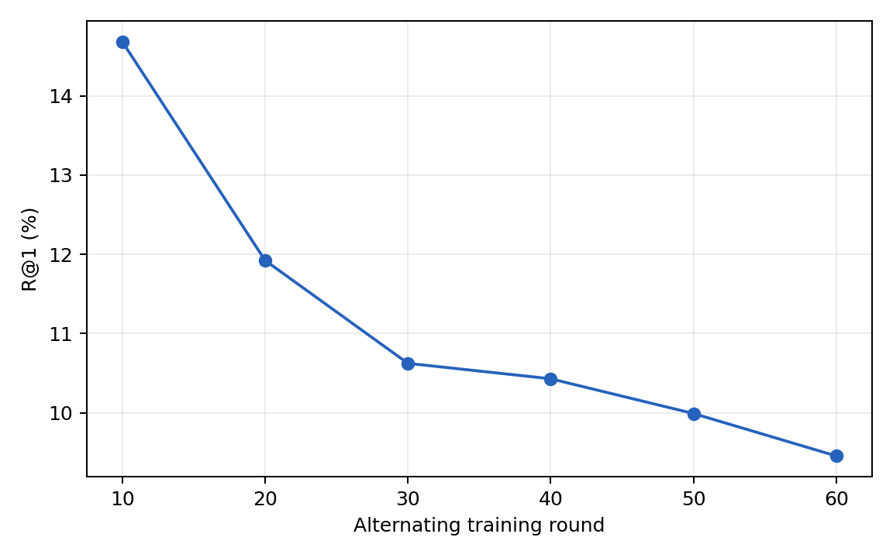
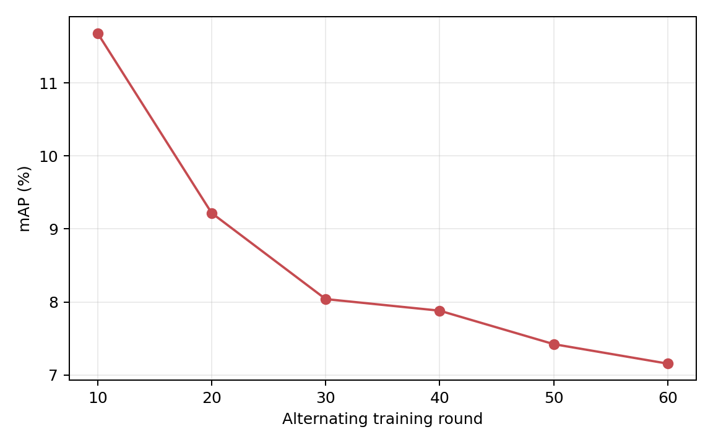

# GH-PushPull-Augmentation-v1：从零60轮与六节点Joint正式Test

**60轮训练、独立CPU审计与六组CUHK-PEDES × IRRA Joint Test全部PASS。**

G/H均从原始seed42初始化，双Adam状态从空开始；未加载历史G10/G60、H7/H10/H60或旧动态Bank。IRRA、Reader、属性空间及固定clean资源沿用。双Optimizer仍无Scheduler，数值权重在训练前固定。

每条Train原图构造原始/局部/全局三视图，G三视图Global取均值，H按当前G三视图库平均SCST奖励；Local/Retain只绑定原始视图。G/H优化共同Train候选KL：靠近当前对方攻击表示，远离自身干净表示。G保留K+1、属性Local/Retain及8/255；H保留原三头SCST和Natural-K每词最多1字符，原R_sim/R_rank只作诊断。每轮2048原始Train、6144图像视图，G/H Adam更新数保持原值。每轮固定2048 Train顺序，先G后完整当前G Bank再H，无Validation优化/评测。

第10/20/30/40/50/60轮分别导出本次G/H；它们不是历史同名Checkpoint。每十轮经前缀CPU审计后执行该节点Test，再恢复下一十轮，3074 Gallery/6156原Query、全部同PID正例、FP32 RGB、图像/文本各逐样本原生编码、Query chunk128。各组独立生成自己的图像和文本，仅Joint评分，没有额外模态/模型/数据集实验。

| 训练轮次 | G | H | R@1 | R@5 | R@10 | mAP |
|---|---|---|---:|---:|---:|---:|
| 10 | G10 | H10 | 14.68 | 26.88 | 33.74 | 11.68 |
| 20 | G20 | H20 | 11.92 | 21.60 | 27.88 | 9.22 |
| 30 | G30 | H30 | 10.62 | 19.79 | 24.97 | 8.04 |
| 40 | G40 | H40 | 10.43 | 19.23 | 24.76 | 7.88 |
| 50 | G50 | H50 | 9.99 | 18.70 | 23.26 | 7.42 |
| 60 | G60 | H60 | 9.45 | 17.71 | 22.97 | 7.16 |

数值单位%。越低攻击越有效；原精度见METRICS.csv。

六个预设节点R@1单调不升，mAP单调不升。仅一条seed42轨迹，不据此声称统计显著，也不额外用Test选点改变方法。

每10轮的G/H权重不可变；每轮保存最新完整双模型/Adam/RNG/Bank身份边界并原子切换，旧新产物按退休回执清理，保留全部小型账本。真实失败不自动重试。

来源、预算和原生独立排名审计见SOURCE_EVIDENCE.json及服务器各组cpu_audit。源码/运行说明见[GH_PUSHPULL_AUG_V1.md](../../GH_PUSHPULL_AUG_V1.md)。权重、Tensor、原始数据和日志不发布Git。
