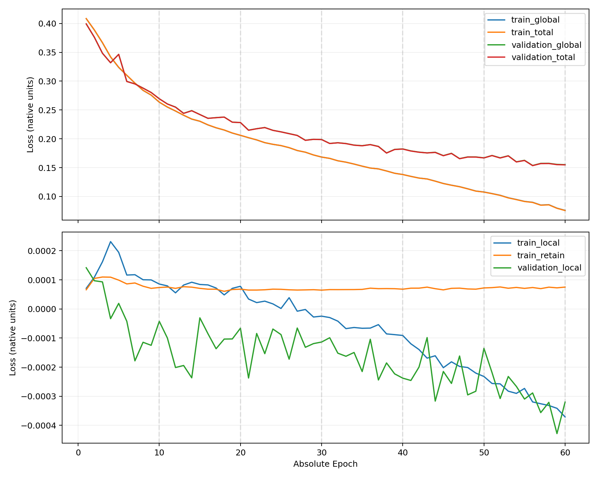

# G-v2 Epoch11→60正式连续训练与独立CPU审计

冻结训练Commit：635471b6d8a722616f87df16c300a8358861cd10。
完整50个新增Epoch及独立CPU审计均PASS，最终Adam step=484080，新增403400次更新。
父Epoch10只读引用；各Epoch2048 Train、128 Validation零更新、8068次Adam。
模型、Global/Local/Retain、逐属性K+1、原图Joint、8/255、Adam2e-4/(.5,.999)保持。
没有Scheduler、FiLM、TV或扰动惩罚，没有生成Gallery或执行三模型Full。

## 曲线与训练统计

原精度数据见loss_raw.csv；Epoch1–10来自原不可变训练摘要，Epoch11–60来自已审计扩展摘要。
这些是训练诊断量，不能代替Test检索效果；不使用Test选择Checkpoint。

| Epoch | Train Total | Validation Total | G gradient L2 mean |
| --- | --- | --- | --- |
| 1 | 0.4084998048 | 0.3993345311 | 0.5815579206 |
| 2 | 0.3888590437 | 0.3761711730 | 0.4083699906 |
| 3 | 0.3667888383 | 0.3483972034 | 0.4248665706 |
| 4 | 0.3422130314 | 0.3318415064 | 0.4190700835 |
| 5 | 0.3240480541 | 0.3464542304 | 0.4212672111 |
| 6 | 0.3102248826 | 0.2993983885 | 0.4311389812 |
| 7 | 0.2966980571 | 0.2950878415 | 0.4457591861 |
| 8 | 0.2841481180 | 0.2878460604 | 0.4619706237 |
| 9 | 0.2759155354 | 0.2802388753 | 0.4468142100 |
| 10 | 0.2636317812 | 0.2694231561 | 0.4505438743 |
| 11 | 0.2551508965 | 0.2603242368 | 0.4653680180 |
| 12 | 0.2482657130 | 0.2548367800 | 0.4580834837 |
| 13 | 0.2409531901 | 0.2440684783 | 0.4706301245 |
| 14 | 0.2343024231 | 0.2486084510 | 0.4757204174 |
| 15 | 0.2305541787 | 0.2420567595 | 0.4797473159 |
| 16 | 0.2241961484 | 0.2354566126 | 0.4531442035 |
| 17 | 0.2191968773 | 0.2365908115 | 0.4524990766 |
| 18 | 0.2152786455 | 0.2376082812 | 0.4503124818 |
| 19 | 0.2100626888 | 0.2287511094 | 0.4500256565 |
| 20 | 0.2061030133 | 0.2281760302 | 0.4518174890 |
| 21 | 0.2019871636 | 0.2147883558 | 0.4372902828 |
| 22 | 0.1981233773 | 0.2174159071 | 0.4493999540 |
| 23 | 0.1933651423 | 0.2194390989 | 0.4379434593 |
| 24 | 0.1904677652 | 0.2146423480 | 0.4259459371 |
| 25 | 0.1882584693 | 0.2119622178 | 0.4420280230 |
| 26 | 0.1846850856 | 0.2088425821 | 0.4328051608 |
| 27 | 0.1797103293 | 0.2057929613 | 0.4244672921 |
| 28 | 0.1768139203 | 0.1973407892 | 0.4200161364 |
| 29 | 0.1719932089 | 0.1990078293 | 0.4210058180 |
| 30 | 0.1683529483 | 0.1986649512 | 0.4257316697 |
| 31 | 0.1660626087 | 0.1918379435 | 0.4239774933 |
| 32 | 0.1619139644 | 0.1930414918 | 0.4245342221 |
| 33 | 0.1594803775 | 0.1916426255 | 0.4181526933 |
| 34 | 0.1562012994 | 0.1889255378 | 0.4279349196 |
| 35 | 0.1525621497 | 0.1878688116 | 0.4355827380 |
| 36 | 0.1492871821 | 0.1898827888 | 0.4372599386 |
| 37 | 0.1478121332 | 0.1866054563 | 0.4260346629 |
| 38 | 0.1442167387 | 0.1752787921 | 0.4386937953 |
| 39 | 0.1402330486 | 0.1814166333 | 0.4265767447 |
| 40 | 0.1380337332 | 0.1822144000 | 0.4314218562 |
| 41 | 0.1348151512 | 0.1787831379 | 0.4320831720 |
| 42 | 0.1318798398 | 0.1767047191 | 0.4347409507 |
| 43 | 0.1302894086 | 0.1754865226 | 0.4361901201 |
| 44 | 0.1265254131 | 0.1763332311 | 0.4404603876 |
| 45 | 0.1223937395 | 0.1706358965 | 0.4419783916 |
| 46 | 0.1194513992 | 0.1745730027 | 0.4429899977 |
| 47 | 0.1168525094 | 0.1654787353 | 0.4544042997 |
| 48 | 0.1132160812 | 0.1682994225 | 0.4448183213 |
| 49 | 0.1092910339 | 0.1682815075 | 0.4490207851 |
| 50 | 0.1075993995 | 0.1668117283 | 0.4566458453 |
| 51 | 0.1048524029 | 0.1708757558 | 0.4522607833 |
| 52 | 0.1018881372 | 0.1666900319 | 0.4562053302 |
| 53 | 0.0975223235 | 0.1703405603 | 0.4556793419 |
| 54 | 0.0945283400 | 0.1598215906 | 0.4532922638 |
| 55 | 0.0912677266 | 0.1623755110 | 0.4592778791 |
| 56 | 0.0896461554 | 0.1534557757 | 0.4629157489 |
| 57 | 0.0848648841 | 0.1570003004 | 0.4548536906 |
| 58 | 0.0854496319 | 0.1571301487 | 0.4695740429 |
| 59 | 0.0794510163 | 0.1551837624 | 0.4563635291 |
| 60 | 0.0756010308 | 0.1548219396 | 0.4570840752 |

## 六个固定Checkpoint

- Epoch10：/home/lzf/ldx/projects/idea-TBPS-test1-github-sync-20261014/prototypes/attribute_image_generator_v2_20261014/outputs/train_v2/checkpoints/epoch_0010/checkpoint.pt；SHA-256：f59bd3b5f9cbbaf8f6acc10c4bdc113ea83cacb2979ea0821b952c8f9a1c658e
- Epoch20：/home/lzf/ldx/outputs/tbps-framework-gv2-epoch60-ablation/train/checkpoints/epoch_0020/checkpoint.pt；SHA-256：67523b3f10b0145d2ba802b1f468f3bbb7554e36d8e1196376f8380d84a51d09
- Epoch30：/home/lzf/ldx/outputs/tbps-framework-gv2-epoch60-ablation/train/checkpoints/epoch_0030/checkpoint.pt；SHA-256：a55e1ec2181cd10ef1436c993231f333a445644b5378ca90a10a99c50143a87d
- Epoch40：/home/lzf/ldx/outputs/tbps-framework-gv2-epoch60-ablation/train/checkpoints/epoch_0040/checkpoint.pt；SHA-256：0b70d802ce867910b10dc70a9581c8a5c31907bf5ab4ace7206411c02f239e82
- Epoch50：/home/lzf/ldx/outputs/tbps-framework-gv2-epoch60-ablation/train/checkpoints/epoch_0050/checkpoint.pt；SHA-256：8357d8cca55d3b26190e85a53a48034985a6cec37274e2e56e894fe808752b86
- Epoch60：/home/lzf/ldx/outputs/tbps-framework-gv2-epoch60-ablation/train/checkpoints/epoch_0060/checkpoint.pt；SHA-256：9148a6ac06178b2eb474194ef6892c50182c5623b4e88bdcf88faa358aa46049

每个Epoch均保留完整不可变Checkpoint；10/20/30/40/50/60为预设消融点。
原始数据、SHA、完成回执及CPU审计来源见evidence.json。
受控训练总耗时16998.382秒（含恢复、逐Epoch缓存验证和保存），
GPU peak allocated/reserved为1083324416/1212153856 bytes，
Peak RSS为2487185408 bytes。启动和阶段耗时另见/home/lzf/ldx/tmp/gv2_epoch60_train_v1/status.log。

历史保护：{'files_sha256_unchanged': 46, 'files_stat_unchanged': 84237}。原G10/H7、缓存和既有Full不变。
只声称完整状态恢复及固定算法/数据顺序，不声称历史CUDA轨迹bitwise等价。
本轮训练/CPU审计已完成，后续攻击样本生成与IRRA/RaSa/APTM评估待用户单独授权。

## Git发布格式修复与状态区分

训练和独立CPU审计已PASS；原监督器在2026-10-20 18:32:44的发布阶段停于
FAIL exit=2 line=83（git diff --cached --check），不是训练失败或审计失败。
错误仅为派生CSV的61个CRLF行尾及Matplotlib SVG的1117处行尾空格。

本次只将CSV转为LF、删除SVG行尾空格；CSV全部单元格字符串exact，650个数值与原摘要exact，
Markdown60行与同一CSV一致；SVG XML图形语义exact，PNG未改变。未重新生成曲线或运行报告生成器。
50份Epoch11–60 Checkpoint、Claim及完成回执仅做只读SHA/元数据核对；没有反序列化模型、
重跑原CPU审计、GPU、训练或任何Full评估。

原phase、status.log、launcher.log、cpu_audit.log、report.log保留原字节和mtime；
原控制phase继续为FAIL，不能把原监督器改记成SUCCESS。
本次Git格式修复通过后单独提交/推送，独立发布成功凭证记录于
/home/lzf/ldx/tmp/gv2_epoch60_train_v1/publication_repair_v1/publication_success.json。
格式前后SHA、650字段对照和保护证据见PUBLICATION_REPAIR.json。
