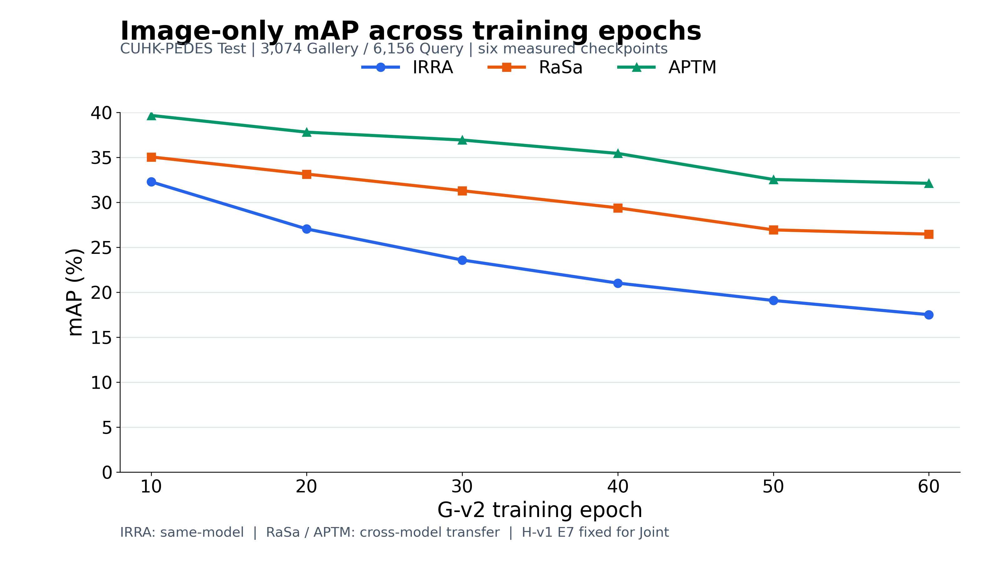
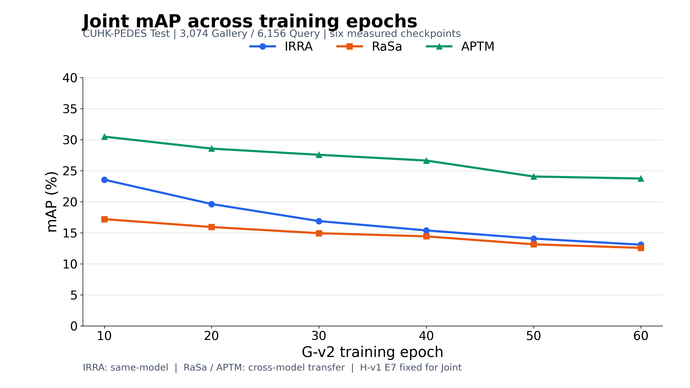
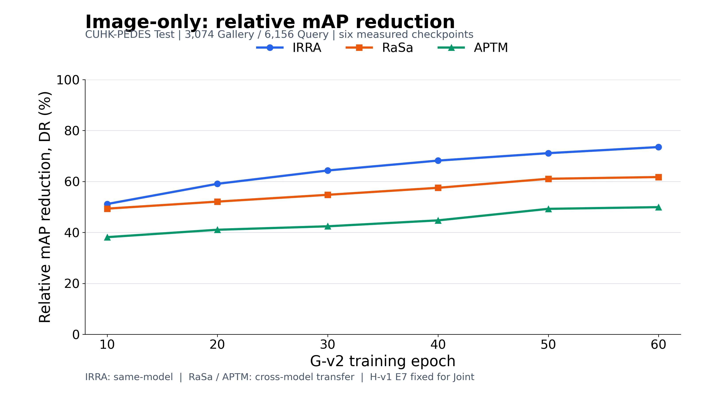
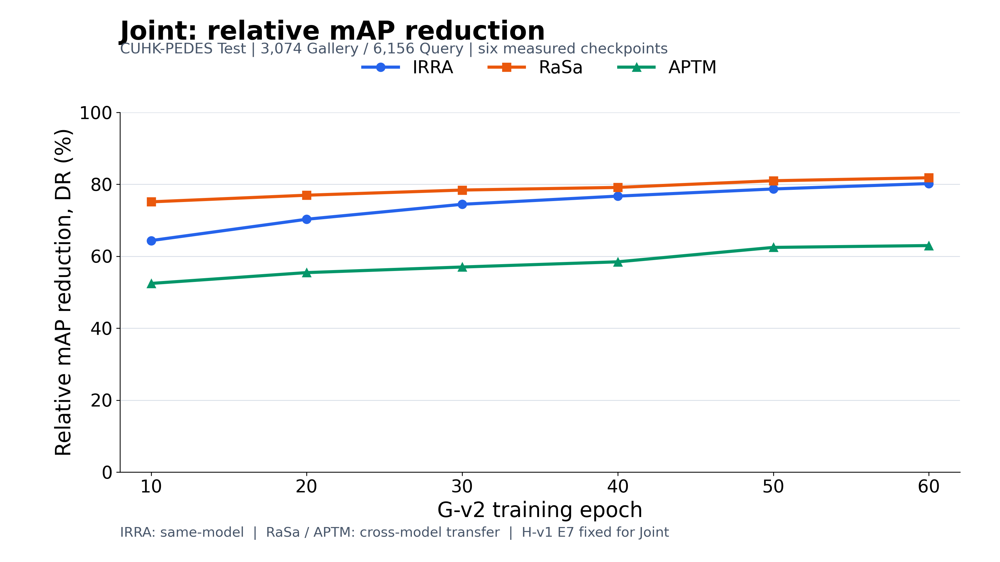
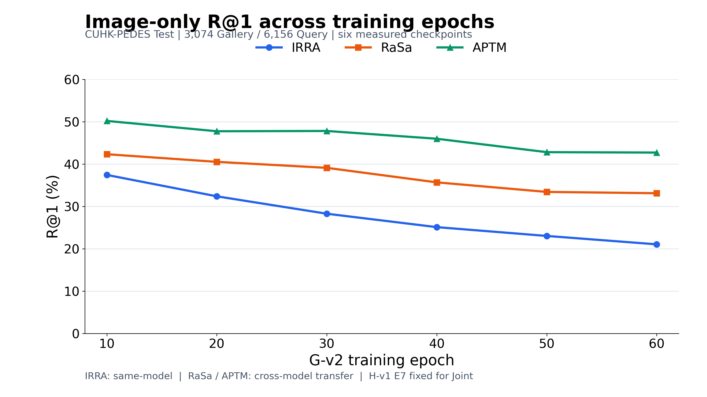
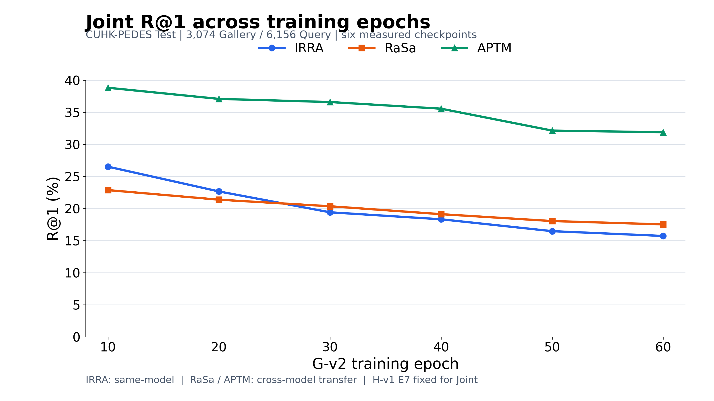

# G-v2 Epoch10–60六节点三模型Full训练轮数消融报告

## 结论与验证边界

正式Full及原有独立CPU审计全部PASS，本次只读完整性核验PASS。
六个预设节点上，IRRA同模型及RaSa/APTM跨模型的Image-only、Joint mAP均随Epoch增加而降低；
E60为本条训练轨迹六节点中的最低mAP，但不是通过独立Validation确认的最优Checkpoint。
本实验只有一条seed42训练轨迹，没有多seed或置信区间，不能宣称统计显著或据此确认过拟合机制。
本轮没有训练、G/H生成、模型前向、完整排名或CPU审计入口重跑。

冻结执行代码6021f3bfdec181785d1baccd7ce4f80a1428b069；启动登记5b187151432dacf5618f7759ed10a211dbf23e2e。
正式区间2026-10-20T20:35:12+08:00至2026-10-21T19:07:27+08:00，总计22小时32分15秒。
[完整性核验](INTEGRITY_REPORT.md)、[来源SHA与完成证据](SOURCE_EVIDENCE.json)。

## 实验设置

CUHK-PEDES官方Test，3074 Gallery、6156 Query，保留全部同PID正例、多Caption、官方顺序和Raw Caption。
固定G-v2 Image-only G(I)、generate_once、原FP32 RGB（不转PIL重新量化）、8/255投影；
仅研究G训练Epoch，H-v1固定E7/visit14336及原6156条Unicode攻击文本。
E10直接引用已审计历史Full，E20/30/40/50/60各生成一次固定3074张Adv Gallery，由三个Victim共享。
总计36条攻击数据（E10历史6条、新Full30条），另有6条独立固定Clean/H-only控制。

IRRA为攻击器训练来源模型上的同模型评估；RaSa/APTM为冻结IRRA训练攻击器的跨模型迁移。
各Victim保留原生预处理、Tokenizer、评分与模型空间；IRRA dot，RaSa原生ITM、APTM原生融合及全集合归一化。
固定FP32/math/no_tf32、Image Batch1、Query Chunk128、RaSa/APTM完整Top128；
原生融合实际每Target×Epoch为1575936 pair，未将Top10 Smoke替代Full。
Clean是各Victim在统一物化输入下的Raw Clean，不直接等同其论文原始设置Clean。
不使用Target梯度或Test结果反向修改G，不依据本次结果改变预设训练长度或选点。

## Image-only与Joint的mAP总览

单位百分数，最终显示两位小数，计算使用原精度。

### Image-only mAP

| Epoch | IRRA | RaSa | APTM |
| --- | --- | --- | --- |
| 10 | 32.28 | 35.05 | 39.66 |
| 20 | 27.04 | 33.14 | 37.80 |
| 30 | 23.58 | 31.29 | 36.93 |
| 40 | 21.02 | 29.39 | 35.44 |
| 50 | 19.09 | 26.94 | 32.54 |
| 60 | 17.51 | 26.47 | 32.11 |

### Joint mAP

| Epoch | IRRA | RaSa | APTM |
| --- | --- | --- | --- |
| 10 | 23.55 | 17.20 | 30.49 |
| 20 | 19.63 | 15.93 | 28.56 |
| 30 | 16.89 | 14.94 | 27.57 |
| 40 | 15.39 | 14.43 | 26.64 |
| 50 | 14.07 | 13.14 | 24.07 |
| 60 | 13.08 | 12.57 | 23.74 |

## 表A：Image-only全部检索指标

| Epoch | Target | R@1 | R@5 | R@10 | mAP |
| --- | --- | --- | --- | --- | --- |
| 10 | IRRA | 37.44 | 60.77 | 70.08 | 32.28 |
| 10 | RaSa | 42.33 | 61.71 | 69.56 | 35.05 |
| 10 | APTM | 50.19 | 70.21 | 77.13 | 39.66 |
| 20 | IRRA | 32.39 | 54.26 | 63.68 | 27.04 |
| 20 | RaSa | 40.53 | 59.55 | 67.74 | 33.14 |
| 20 | APTM | 47.76 | 68.13 | 75.23 | 37.80 |
| 30 | IRRA | 28.28 | 48.62 | 57.28 | 23.58 |
| 30 | RaSa | 39.12 | 57.18 | 65.50 | 31.29 |
| 30 | APTM | 47.82 | 68.01 | 75.24 | 36.93 |
| 40 | IRRA | 25.11 | 43.79 | 52.62 | 21.02 |
| 40 | RaSa | 35.69 | 55.12 | 63.19 | 29.39 |
| 40 | APTM | 45.99 | 66.50 | 73.88 | 35.44 |
| 50 | IRRA | 23.03 | 40.29 | 48.83 | 19.09 |
| 50 | RaSa | 33.43 | 51.19 | 59.37 | 26.94 |
| 50 | APTM | 42.82 | 63.37 | 71.15 | 32.54 |
| 60 | IRRA | 21.05 | 37.88 | 45.52 | 17.51 |
| 60 | RaSa | 33.12 | 50.49 | 58.46 | 26.47 |
| 60 | APTM | 42.72 | 62.00 | 69.95 | 32.11 |

## 表B：Joint全部检索指标

| Epoch | Target | R@1 | R@5 | R@10 | mAP |
| --- | --- | --- | --- | --- | --- |
| 10 | IRRA | 26.53 | 46.83 | 57.20 | 23.55 |
| 10 | RaSa | 22.87 | 34.68 | 40.12 | 17.20 |
| 10 | APTM | 38.82 | 58.74 | 66.60 | 30.49 |
| 20 | IRRA | 22.66 | 40.95 | 50.37 | 19.63 |
| 20 | RaSa | 21.38 | 32.98 | 38.40 | 15.93 |
| 20 | APTM | 37.09 | 56.63 | 63.89 | 28.56 |
| 30 | IRRA | 19.41 | 36.47 | 45.29 | 16.89 |
| 30 | RaSa | 20.35 | 31.51 | 36.55 | 14.94 |
| 30 | APTM | 36.60 | 55.43 | 62.85 | 27.57 |
| 40 | IRRA | 18.32 | 32.89 | 41.23 | 15.39 |
| 40 | RaSa | 19.12 | 30.73 | 35.30 | 14.43 |
| 40 | APTM | 35.56 | 54.04 | 61.47 | 26.64 |
| 50 | IRRA | 16.47 | 30.73 | 38.61 | 14.07 |
| 50 | RaSa | 18.05 | 28.78 | 33.53 | 13.14 |
| 50 | APTM | 32.15 | 51.07 | 58.25 | 24.07 |
| 60 | IRRA | 15.72 | 28.56 | 36.39 | 13.08 |
| 60 | RaSa | 17.53 | 27.73 | 32.26 | 12.57 |
| 60 | APTM | 31.89 | 50.05 | 57.12 | 23.74 |

## 表C：固定控制组

| Target | Attack Method | R@1 | R@5 | R@10 | mAP |
| --- | --- | --- | --- | --- | --- |
| IRRA | Clean | 73.15 | 89.88 | 93.71 | 66.10 |
| IRRA | H-v1 Text-only | 56.58 | 75.97 | 82.52 | 51.47 |
| RaSa | Clean | 76.22 | 90.29 | 94.09 | 69.18 |
| RaSa | H-v1 Text-only | 39.93 | 50.26 | 53.41 | 32.86 |
| APTM | Clean | 74.61 | 89.26 | 93.18 | 64.13 |
| APTM | H-v1 Text-only | 60.80 | 78.14 | 83.77 | 51.80 |

## 表D：全部原始精度

42条原精度Markdown完整表见[TABLE_D_RAW.md](TABLE_D_RAW.md)，
[全部原精度CSV](all_metrics_raw.csv)保留36条攻击与6条控制，不将控制组重复当作独立实验。
[36条攻击原精度CSV](metrics_raw.csv)、[两位小数CSV](metrics_2dp.csv)、
[控制原精度CSV](controls_raw.csv)。

## 下降率、百分点与Joint增量

DR_mAP=(Clean_mAP−Attack_mAP)/Clean_mAP×100%；DR_R1同理。
原始mAP及R@1单位为百分数；Clean−Attack为绝对下降百分点(pp)；
DR是相对下降率(%)，二者不能混用。Joint额外下降=Image-only_mAP−Joint_mAP，正值表示Joint更强。
所有计算均先使用原始浮点数，最后显示时才四舍五入。

### mAP DR（%）

| Epoch | IRRA Image | IRRA Joint | RaSa Image | RaSa Joint | APTM Image | APTM Joint |
| --- | --- | --- | --- | --- | --- | --- |
| 10 | 51.16 | 64.37 | 49.34 | 75.13 | 38.15 | 52.45 |
| 20 | 59.09 | 70.29 | 52.10 | 76.98 | 41.05 | 55.46 |
| 30 | 64.32 | 74.45 | 54.77 | 78.41 | 42.41 | 57.01 |
| 40 | 68.20 | 76.72 | 57.52 | 79.15 | 44.74 | 58.46 |
| 50 | 71.13 | 78.71 | 61.07 | 81.00 | 49.26 | 62.47 |
| 60 | 73.51 | 80.21 | 61.74 | 81.83 | 49.93 | 62.98 |

### R@1 DR（%）

| Epoch | IRRA Image | IRRA Joint | RaSa Image | RaSa Joint | APTM Image | APTM Joint |
| --- | --- | --- | --- | --- | --- | --- |
| 10 | 48.81 | 63.74 | 44.46 | 69.99 | 32.72 | 47.96 |
| 20 | 55.72 | 69.02 | 46.82 | 71.95 | 35.99 | 50.29 |
| 30 | 61.34 | 73.46 | 48.68 | 73.29 | 35.90 | 50.95 |
| 40 | 65.67 | 74.95 | 53.18 | 74.91 | 38.36 | 52.34 |
| 50 | 68.51 | 77.48 | 56.14 | 76.32 | 42.61 | 56.91 |
| 60 | 71.22 | 78.50 | 56.54 | 77.00 | 42.74 | 57.26 |

### Joint相对Image-only额外mAP下降（百分点）

| Epoch | IRRA | RaSa | APTM |
| --- | --- | --- | --- |
| 10 | 8.73 | 17.84 | 9.17 |
| 20 | 7.40 | 17.21 | 9.24 |
| 30 | 6.70 | 16.35 | 9.37 |
| 40 | 5.63 | 14.96 | 8.80 |
| 50 | 5.02 | 13.79 | 8.47 |
| 60 | 4.43 | 13.90 | 8.37 |

全部36条DR_mAP、DR_R1、相对Clean的mAP下降百分点及Joint额外下降见
[derived_raw.csv](derived_raw.csv)、[展示版](derived_2dp.csv)。

## Results / Ablation Study

### 训练轮数与同模型/迁移效果

| Target | Image mAP E10→60 | 下降(pp) | Joint mAP E10→60 | 下降(pp) | Image R@1下降(pp) | Joint R@1下降(pp) |
| --- | --- | --- | --- | --- | --- | --- |
| IRRA | 32.28 → 17.51 | 14.77 | 23.55 → 13.08 | 10.47 | 16.39 | 10.80 |
| RaSa | 35.05 → 26.47 | 8.58 | 17.20 → 12.57 | 4.63 | 9.21 | 5.34 |
| APTM | 39.66 → 32.11 | 7.55 | 30.49 → 23.74 | 6.75 | 7.47 | 6.94 |

在这六个预设节点上，三模型两种模式mAP均逐步降低，未观察到IRRA mAP增强而RaSa/APTM mAP退化。
Image-only的E10→60绝对mAP降幅分别为14.77、8.58、7.55个百分点；
Joint分别为10.47、4.63、6.75个百分点。IRRA变化范围更大，说明在本实验轨迹中同模型评估对Epoch变化更敏感；
不能把不同Victim基线和评分机制下的绝对指标当作统一迁移能力尺度。

R@1并非所有序列严格单调：APTM Image-only由E20的47.75828552246094变为E30的47.82326126098633，
上升0.06497573852539062个百分点，但同期mAP由37.80降至36.93。
因此不能笼统声称所有检索指标在每个区间都同步增强，亦不对该小幅变化声称统计显著。

### 固定H带来的额外收益

全部18个Epoch×Victim组合中Joint mAP低于对应Image-only。
IRRA的额外mAP下降从8.73缩至4.43个百分点；RaSa从17.84缩至13.90；
APTM从9.17变为8.37，期间并非单调。
固定H并不意味着Joint相对Image-only的数值增益恒定。
这只是两种固定输入组合的检索差异，不能单凭该差值推断某种已验证的图文因果协同机制。

### 后期收益与最低节点

| Target | Image-only最低mAP | Epoch | Joint最低mAP | Epoch |
| --- | --- | --- | --- | --- |
| IRRA | 17.51 | 60 | 13.08 | 60 |
| RaSa | 26.47 | 60 | 12.57 | 60 |
| APTM | 32.11 | 60 | 23.74 | 60 |

六节点最低mAP均在E60，未观察到较早节点拥有更强mAP迁移效果。
E50→60 Image-only mAP额外下降IRRA1.58、RaSa0.47、APTM0.43个百分点，
Joint分别0.99、0.57、0.33个百分点。
RaSa/APTM在最后区间的新增收益较小，但前面区间并非始终递减，
且E60仍有改善，不能据此证明已经饱和或确定更长训练无效。
这些最低值仅为预设节点的描述性统计，不用于Test选Checkpoint或后续优化。

### 训练/Validation Loss与检索结果

| Epoch | Train Total | Validation Total |
| --- | --- | --- |
| 10 | 0.26363178 | 0.26942316 |
| 20 | 0.20610301 | 0.22817603 |
| 30 | 0.16835295 | 0.19866495 |
| 40 | 0.13803373 | 0.18221440 |
| 50 | 0.10759940 | 0.16681173 |
| 60 | 0.07560103 | 0.15482194 |

六个节点Train Total与内部Validation Total均逐步降低，分别由0.2636317812降至0.0756010308、
0.2694231561降至0.1548219396。同期三个Victim的mAP均改善。
就mAP而言，本组数据没有支持“Loss下降而跨模型攻击变差”的观察；
就R@1而言，存在上述APTM E20→30的微小反向变化。
全部60轮的Train/Validation Total上升次数分别为1／19，
因此六个节点下降不等于全部训练过程无波动。
Loss是训练/内部Validation诊断，不是官方Test检索指标，也不能保证未知模型迁移。
未发现能够仅凭这些数据直接断言过拟合的证据；单轨迹、无置信区间及有限评估节点限制机理解释。
[历史训练曲线](../gv2_epoch60_training/loss_curves.png)、[本次引用的Loss原精度](training_loss_reference_raw.csv)。

## 六张消融曲线

实际数值Epoch轴[10,20,30,40,50,60]；仅连接实测节点，无插值、平滑或虚构点。
全图IRRA蓝、RaSa橙、APTM绿；mAP/DR/R@1分轴分图；16:9，PNG 3200×1800，SVG保留矢量文字。
[绘图原精度数据](curve_data_raw.csv)。

### Image-only attack across training epochs

[PNG](figures/01_image_only_map.png) · [SVG](figures/01_image_only_map.svg)

### Joint attack across training epochs

[PNG](figures/02_joint_map.png) · [SVG](figures/02_joint_map.svg)

### Image-only: relative mAP reduction

[PNG](figures/03_image_only_map_dr.png) · [SVG](figures/03_image_only_map_dr.svg)

### Joint: relative mAP reduction

[PNG](figures/04_joint_map_dr.png) · [SVG](figures/04_joint_map_dr.svg)

### Image-only attack across training epochs

[PNG](figures/05_image_only_r1.png) · [SVG](figures/05_image_only_r1.svg)

### Joint attack across training epochs

[PNG](figures/06_joint_r1.png) · [SVG](figures/06_joint_r1.svg)

## 运行成本与来源保护

| Target | 单会话最大reserved(GiB) | 单会话最大RSS(GiB) | 5个新Epoch评分会话耗时合计(h) |
| --- | --- | --- | --- |
| IRRA | 0.979 | 2.256 | 0.144 |
| RaSa | 2.033 | 21.141 | 9.858 |
| APTM | 1.049 | 6.076 | 10.204 |

评分会话耗时不包括其前置CPU来源核验和独立CPU审计，不能与整链22小时32分15秒混用。
5次G生成会话各3074次前向，总计15370；H新恢复/前向、Backward/Optimizer/JVP均0；
三Victim各5次恢复、15370张新图像编码，原生文本新编码0。
GPU共用造成的吞吐干扰已保留在原资源快照，本报告不作等硬件独占速度比较。
原参数/buffers摘要全部一致；各图最大L∞为0.0313725471496582≤8/255（引用已完成数值审计）。

107项producer、六Checkpoint和固定配置均与冻结协议一致；全部34721个新产物回执/声明SHA通过，
CSV与summary/Engine对应四指标原精度完全一致；无pending、孤立Claim、失败产物或缺失结果。
原74184份历史stat/289 SHA不变；原Full和已使用文件前后stat不变。
本轮只新增本目录派生表格/图/文档并更新统一项目状态，没有改原Full、Smoke、权重、训练数据或算法。

## 文件索引

- metrics_raw.csv / metrics_2dp.csv：36条正式攻击记录。
- all_metrics_raw.csv / TABLE_D_RAW.md：42条完整原精度数据及独立控制。
- controls_raw.csv / controls_2dp.csv：三个Victim的Clean/H-only。
- table_A_image_only_2dp.csv、table_B_joint_2dp.csv：论文/PPT完整四指标。
- derived_raw.csv / derived_2dp.csv：两项DR、mAP百分点下降及Joint额外下降。
- curve_data_raw.csv、figures/*.png/*.svg：六张曲线和原始点。
- training_loss_reference_raw.csv：历史Loss只读引用；statistics.json：最低节点、变化及统计限制。
- SOURCE_EVIDENCE.json、INTEGRITY_REPORT.md：来源、SHA、完成及原有CPU审计证据。
