# H-v1 G60适配续训：完整训练动态、逐Query证据与研究决策

日期：2026-10-22。性质：CPU只读事后分析。原实验与失败发布现场保持不变。

## 核心结果总表

指标单位为百分数；mAP与额外下降保留6位以显露H9/H20的细微差别。额外下降=同一G60 Image-only mAP−Joint mAP，单位为百分点。

| H Epoch | 训练图像引导 | Text-only R@1 (%) | Text-only mAP (%) | Joint R@1 (%) | Joint mAP (%) | Joint额外下降 (pp) |
| --- | --- | --- | --- | --- | --- | --- |
| 7 | G10 | 94.53 | 96.321609 | 32.81 | 41.593338 | 7.215275 |
| 9 | G10 | 93.75 | 95.937500 | 32.81 | 40.425480 | 8.383133 |
| 10 | G10 | 95.31 | 96.972656 | 32.81 | 41.691406 | 7.117207 |
| 20 | H10后G60适配 | 98.44 | 99.283859 | 31.25 | 40.427635 | 8.380978 |
| 30 | H10后G60适配 | 98.44 | 98.860672 | 33.59 | 41.854614 | 6.953999 |
| 40 | H10后G60适配 | 97.66 | 98.470047 | 32.81 | 41.223633 | 7.584980 |
| 50 | H10后G60适配 | 97.66 | 98.697922 | 33.59 | 42.295166 | 6.513447 |
| 60 | H10后G60适配 | 98.44 | 99.218750 | 35.16 | 42.874081 | 5.934532 |


固定128 Gallery/128 Query、121 PID；Clean mAP=100%，G60 Image-only mAP=48.80861282348633%。
H1–H10训练使用G10奖励图库；H20–H60从原H10状态切换G60适配，**不是相同条件下完整单因素训练曲线**。
H20是五个新增预设候选中最低Joint mAP；全部15个候选的最低仍是历史H9。
这些只是重复内部Validation上的描述性最小值，未发布新Selection，未用Test选模。

**核心结论：**训练奖励确实提高，后期有效SCST梯度更稀疏，动作出现部分保守化；
但不能把它们直接当作Joint退化的唯一原因。最强的直接证据是：现奖励与完整多正例AP并不等价，
同一Validation上也存在Reward更大而Joint mAP更高的候选。H20与H9几乎持平来自样本级正负变化抵消，
不是全部Query表现相同。当前训练是G→H的单向条件引导，不是端到端双模态联合训练。

## 1. 原始实验完成与失败状态核验

| 项目 | 真实状态 |
| --- | --- |
| 正式H11–H60 | HV1_G60_TRAINING_PASS；新增102400 visits/101850更新 |
| 累计账本 | 122880 visits/122220 Adam更新；50轮均2048/2037/11 |
| 新Checkpoint | 400份周期/边界版本，含50份完整Epoch边界，链/关联日志/字节SHA核对 |
| 独立CPU审计 | 已有HV1_G60_VERSIONED_CPU_AUDIT_PASS；本轮只读验证回执，不重跑入口 |
| G/IRRA | G60固定图库2048张；训练G加载/图像前向0，IRRA参数buffers前后exact |
| 原控制器 | FAIL exit=1，WRITING_REPORT阶段Python3.10缺hashlib.file_digest |
| 本轮行为 | 不修复旧发布器、不重训、不编码、不使用GPU、不执行Full排名 |
| 保护 | 151378份历史stat及18617份实验/控制/失败报告文件状态保持；113原producer SHA通过 |

正式输出：/home/lzf/ldx/outputs/tbps-framework-hv1-g60-adaptation-epoch60/。
控制目录：/home/lzf/ldx/tmp/hv1_g60_adaptation_epoch60_v1/。
原执行代码9765a536a11a9a0e9111f2f834230c53d41bf2d8；
独立审计修复135df869b81d728261a625ca6e4a2c6b8b7f2ae5；启动cb51cd3c0f11041fadb072c2f0853b222a649421。
没有把原FAIL改写为监督器SUCCESS；训练/审计成功与原Git发布失败分别记录。

原H10完整H/Adam/Python/NumPy/CPU/CUDA RNG恢复exact，起点20480/20370，不继承4-step Smoke。
累计Adam更新是优化器调用账本，不要求每个参数的Adam step相同；原参数动量和不同step原样恢复。
内部Train/Validation均属于official train，2048/128身份、PID及官方Test PID隔离已核验。
路径含test_query不代表official Test，角色以annotation和成员身份为准。

本轮流式读取历史20480及新增102400条Visit，合计122880条；没有把全部动作日志驻留内存。
读取核验10690份输入、约4.745GiB，670个新式Artifact；评分仅21组已存小矩阵：
1组G60 Image-only、15组Joint、5组新增Text-only，均为已有128×128 FP32分数。
这些矩阵的原生Ranking索引和四项汇总与独立提取的官方rank函数逐值一致。
本轮统计执行53.847秒，Peak RSS约692.0MiB；GPU/模型/编码/旧审计入口调用均0。

## 2. 实际训练目标与权限

以同一Query的原文t、攻击文本t'，固定原图图库I及G60图库I_g，归一化IRRA评分s为例：

```text
R_sim(t') = s(I_g[paired], t) - s(I_g[paired], t')
M_g(t) = max_{same PID} s(I_g, t) - max_{different PID} s(I_g, t)
R_rank(t') = M_g(t) - M_g(t')
R_total(t') = R_sim(t') + R_rank(t')
Advantage = detach(R_total(sampled) - R_total(greedy))
L_SCST = -Advantage * sum(log pi_H(sampled actions | caption))
synergy_increment = [s(I_g[paired],t)-s(I_g[paired],t')]
                    -[s(I[paired],t)-s(I[paired],t')]
```

H通过SCST最大化期望R_total，IRRA/Unicode/Tokenizer不反传，只有H的动作log-prob参与梯度。
两个奖励权重均1；**synergy_increment、clean_sim_drop、clean_margin_drop只记录，不是额外Loss或Reward项**。
负synergy不等于Joint无效；其量纲为正确配对相似度差分，不是mAP增益。

正例是2048 Train Gallery的全部同PID图像，负例是不同PID图像；R_sim使用真实配对的训练图像索引。
PID/配对/图库仅在RewardBank绑定层，H.forward/attack仅接Caption与其Canonical/type/Span。
Train/Validation/Test权限没有混用。H推理不接收图像、PID、检索评分或测试标签。

源码证据：rewards.py的RewardEvaluator.evaluate_many；scst.py的scst_loss；
phase4_training.py的train_step；formal_training/runtime.py的RewardBank.bind、FreshReward.evaluate_many。
实际行号、文件SHA与路径见code_evidence.csv。

### 2.1 为什么奖励不是mAP

R_sim只约束一个配对正例分数，R_rank只约束最佳正例与最高分负例；AP依赖全部同PID正例在全部Gallery中的排名。
保持最优正例/最难负例分数不变，其他正例或负例的顺序仍可改变AP；
分数有变化但未越过排名边界时，Reward也可能变而AP不变。
SCST将这一非等价目标的期望推高，不会自动补上AP目标。

Validation有114条单正例Query和14条双正例Query，后者来自7个双图PID；不能简化成唯一正确图像。
下文的逐Query AP均保留多正例、官方sort/tie行为且无camera过滤。

## 3. 全部50轮训练动态

下表是在线训练期间均值，不是重新评估该冻结Checkpoint的奖励。每轮奖励/梯度分母2037，
另外11条资格失败仍计入2048 visits但不产生奖励/Adam更新，不能与“合法零梯度更新”混为一谈。

| Epoch | Sampled R | Greedy R | R_sim (sampled) | R_rank (sampled) | Loss均值 | 零梯度 % | 同文本 % | Greedy编辑数 | 参数ΔL2均值 |
| --- | --- | --- | --- | --- | --- | --- | --- | --- | --- |
| 10 | 0.057139 | 0.062018 | 0.026545 | 0.030594 | -0.020572 | 57.63 | 57.63 | 2.207 | 0.005240 |
| 11 | 0.011486 | 0.013344 | 0.002648 | 0.008838 | -0.008934 | 61.51 | 61.51 | 2.143 | 0.005519 |
| 20 | 0.031844 | 0.033400 | 0.015519 | 0.016325 | -0.006523 | 64.46 | 64.46 | 1.889 | 0.005383 |
| 30 | 0.037856 | 0.038705 | 0.019430 | 0.018426 | -0.004716 | 76.63 | 76.63 | 1.736 | 0.004827 |
| 40 | 0.039858 | 0.041531 | 0.019101 | 0.020757 | -0.004853 | 77.66 | 77.66 | 1.894 | 0.005452 |
| 50 | 0.044841 | 0.046019 | 0.022505 | 0.022336 | -0.005867 | 79.19 | 79.19 | 1.806 | 0.004750 |
| 60 | 0.042965 | 0.044733 | 0.021005 | 0.021961 | -0.004949 | 82.18 | 82.18 | 1.867 | 0.004955 |


### 3.1 奖励提高，但后期增益放缓

E11→E60 Sampled R 0.011486→0.042965，
R_sim 0.002648→0.021005，
R_rank 0.008838→0.021961，两项都贡献后期奖励。
E41–50与E51–60的Sampled十轮均值为0.042717与0.043619；最后十轮线性斜率约-0.00002285/Epoch。
这支持“后期波动、边际提升放缓”的描述，**不证明达到理论奖励上限或优化已收敛**。
H10的0.057139来自G10图库，不能拿它与切换G60后的E11直接比较来判断模型突然变坏。

### 3.2 Sampled/Greedy趋同与梯度稀疏

E20→E60同文本比例64.46%→82.18%，同编辑/决策轨迹52.92%→71.18%；
Advantage标准差0.041159→0.025084。全部50轮同文本比例与零梯度比例完全相等，
符合相同文本→相同奖励→Advantage零→SCST梯度零的源码机制。
但平均Advantage从−0.001556到−0.001768并非单调逼近零，不能说所有奖励差异消失。

反对“梯度整体消失”的证据也存在：E20/E60平均梯度0.353605/0.325537；
只在非零梯度上条件均值0.994881→1.826773。信号发生更少，不代表每次非零信号更小。
E60仍有363/2037次非零梯度更新。Replacement Head更稀疏：E20为318/2037，E60为121/2037，
但没有真实动作概率/熵记录，不能把这些频率当作策略熵或宣布模式坍塌。

### 3.3 参数仍在变化，SCST Loss不能当攻击指标

合法101850个Adam步的parameter_delta_l2均非零；E20/E60均值为0.005383/0.004955。
E60的1674个零当前梯度步仍有参数变化，符合原Adam动量机制；没有重初始化Optimizer。
Loss中位数均为0，均值趋近0不能等同最优攻击；大量零Advantage直接使Loss为0。
Loss、梯度、Reward的均值/std/min/p05/p25/median/p75/p95/max与正/负/零计数完整保存在training_metric_distributions.csv。

所有50轮均列于文末附表和training_epoch_statistics.csv；逐轮资源时间另见training_resource_epoch_statistics.csv。
资格固定、模型冻结及没有NaN/中断的结论来自原完成/独立审计回执及本次连续日志检查，而非只凭曲线猜测。

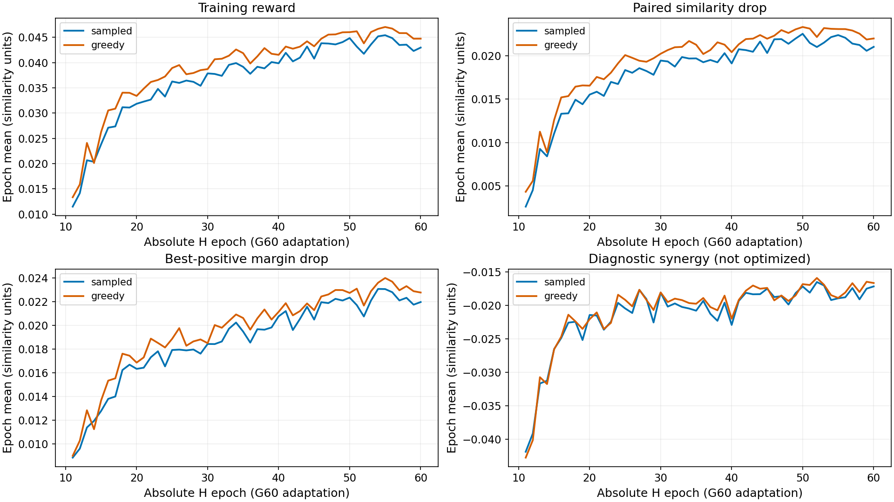
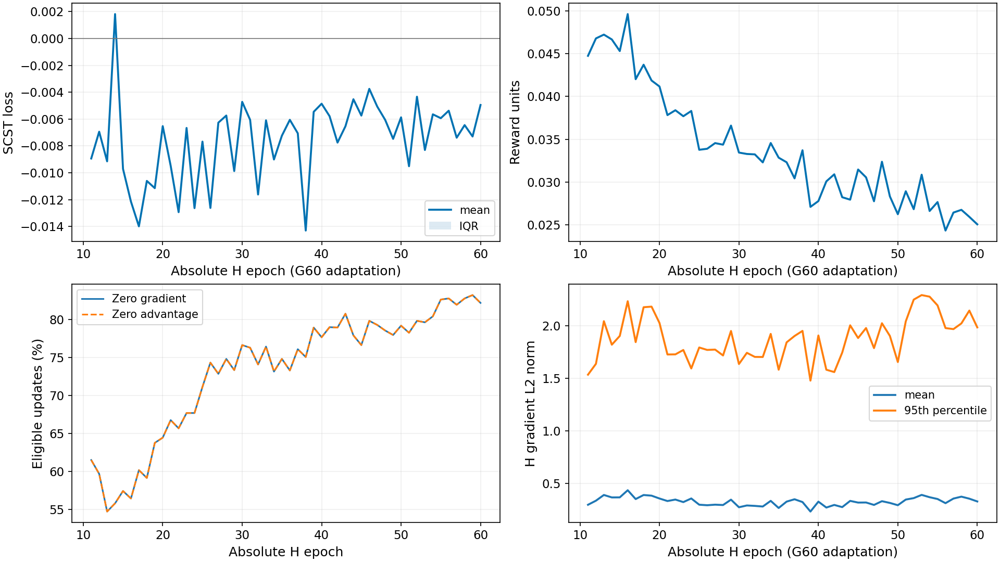
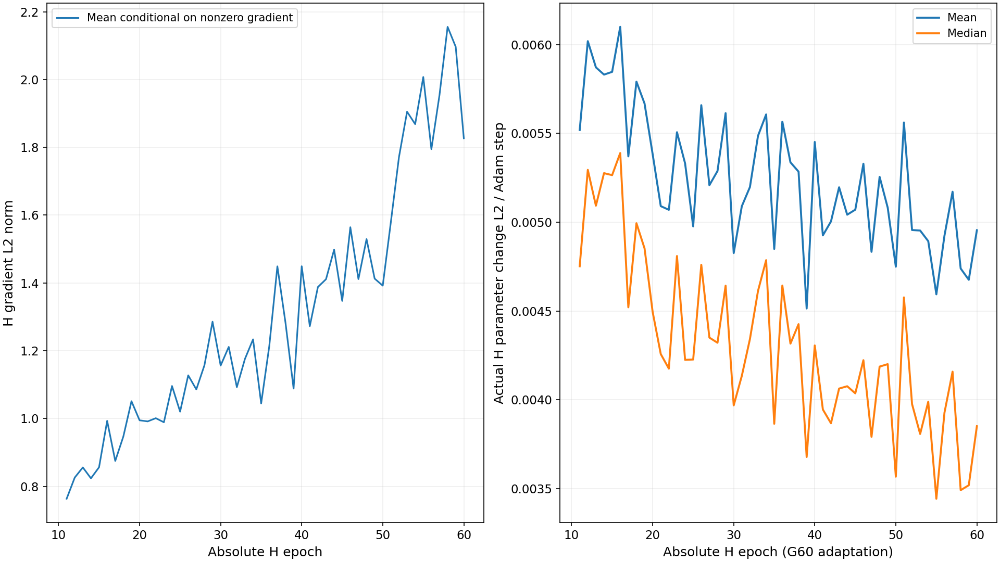

## 4. 全部15个H候选的固定G60 Validation

| H Epoch | 训练图像引导 | Text-only R@1 | Text-only mAP | Joint R@1 | Joint mAP | 额外下降 pp |
| --- | --- | --- | --- | --- | --- | --- |
| 1 | G10 | 95.31 | 97.363281 | 34.38 | 43.508644 | 5.299969 |
| 2 | G10 | 95.31 | 97.363281 | 32.81 | 42.101486 | 6.707127 |
| 3 | G10 | 92.97 | 95.865883 | 32.81 | 42.662766 | 6.145847 |
| 4 | G10 | 93.75 | 96.040306 | 34.38 | 42.830734 | 5.977879 |
| 5 | G10 | 93.75 | 96.365829 | 32.81 | 42.484890 | 6.323723 |
| 6 | G10 | 94.53 | 96.777344 | 32.03 | 41.426025 | 7.382587 |
| 7 | G10 | 94.53 | 96.321609 | 32.81 | 41.593338 | 7.215275 |
| 8 | G10 | 94.53 | 96.263031 | 33.59 | 41.314072 | 7.494541 |
| 9 | G10 | 93.75 | 95.937500 | 32.81 | 40.425480 | 8.383133 |
| 10 | G10 | 95.31 | 96.972656 | 32.81 | 41.691406 | 7.117207 |
| 20 | G60适配 | 98.44 | 99.283859 | 31.25 | 40.427635 | 8.380978 |
| 30 | G60适配 | 98.44 | 98.860672 | 33.59 | 41.854614 | 6.953999 |
| 40 | G60适配 | 97.66 | 98.470047 | 32.81 | 41.223633 | 7.584980 |
| 50 | G60适配 | 97.66 | 98.697922 | 33.59 | 42.295166 | 6.513447 |
| 60 | G60适配 | 98.44 | 99.218750 | 35.16 | 42.874081 | 5.934532 |


Raw Clean和Image-only固定不重算。H1–H10是旧G10引导训练，H20–H60为适配分支；
10→20之间未保存逐Epoch Validation点，不插值生成观测，也不声称这是一条纯训练长度单因素曲线。

H20比H10低1.263771pp，说明这个已选内部集合上有观察到的适配改进；
但它比历史H9高0.002155pp，不能称超越历史最低值。
H20→30变弱，H30→40改善约0.631pp，H40→50→60又变弱，**不是每个后续节点都持续恶化**。

Text-only也非单调变弱：H20→H40 mAP从99.283859降至98.470047，独立文本攻击反而增强，
之后H60回升到99.218750；H60相对H20仍略低0.065109pp。
准确说法是：新增候选总体比历史H9更接近Clean，不能说“训练越晚Text-only越弱”。

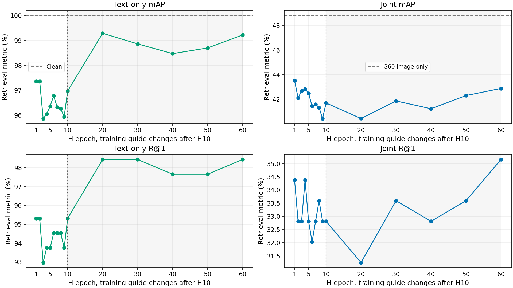
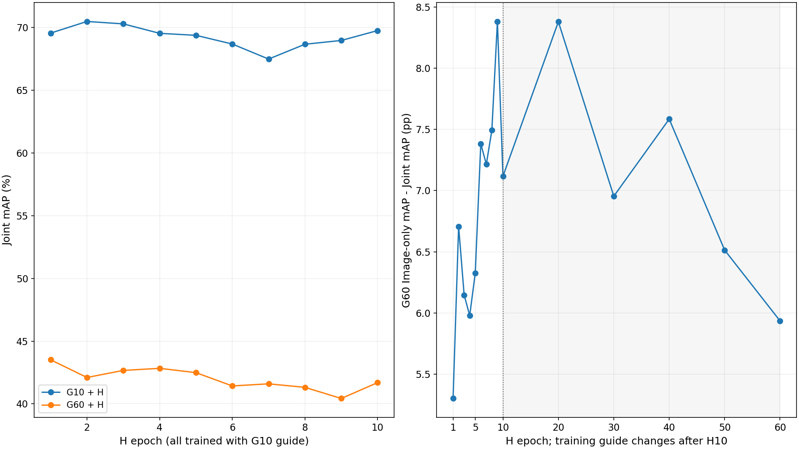

## 5. 逐Query：H9与H20为何近似持平

H9→H20有38条AP升高（攻击变弱）、36条AP下降（攻击变强）、54条不变。
正向AP变化贡献+2.578872pp，负向贡献-2.576715pp，几乎抵消。
这不是全部Query相同，也不能仅由“净少2个Rank-1命中”推出mAP更低。

### 5.1 Rank-1净少2条实际是3条新失败、1条恢复

| Query index | row_id | 正例数 | H9→H20 Rank-1 | 最佳正例排名 | AP H9→H20 | Margin H9→H20 |
| --- | --- | --- | --- | --- | --- | --- |
| 13 | cuhk:9025:0 | 2 | 0→1 | 14→1 | 0.0883→0.8333 | -0.083256→0.016838 |
| 41 | cuhk:23991:0 | 1 | 1→0 | 1→2 | 1.0000→0.5000 | 0.008785→-0.019334 |
| 71 | cuhk:28682:0 | 1 | 1→0 | 1→2 | 1.0000→0.5000 | 0.000887→-0.000184 |
| 121 | cuhk:31297:0 | 1 | 1→0 | 1→4 | 1.0000→0.2500 | 0.009095→-0.059135 |


因此没有唯一的“两条Query名单”：必须同时报告3个丢失命中与1个恢复命中。
Query13有两个PID正例，Rank-1正确时AP仍是0.833333而非1，说明多正例实现确实被保留。

把“攻击成功”限定为Image-only本来Rank-1正确、Joint后错误，H9/H20成功集合分别11/12条，
交集10、并集13、Jaccard=0.7692。
这与“Joint全部错误Query集合”不同，不能把Image-only已经错误的样本都算作H新增成功。

### 5.2 H60相对H20主要在哪里变弱

H20→H60有29条AP升高、20条下降、79条不变；5条Rank-1恢复正确，没有反方向的新Rank-1失败。
它们是：

| Query index | row_id | AP H20→H60 | 最佳正例排名 | 编辑数H20→H60 | Margin H20→H60 |
| --- | --- | --- | --- | --- | --- |
| 7 | cuhk:29597:0 | 0.5000→1.0000 | 2→1 | 1→2 | -0.009643→0.085322 |
| 58 | cuhk:3731:0 | 0.5000→1.0000 | 2→1 | 2→2 | -0.010660→0.025051 |
| 71 | cuhk:28682:0 | 0.5000→1.0000 | 2→1 | 2→2 | -0.000184→0.000887 |
| 77 | cuhk:9758:0 | 0.5000→1.0000 | 2→1 | 2→1 | -0.007086→0.053693 |
| 121 | cuhk:31297:0 | 0.2500→1.0000 | 4→1 | 2→1 | -0.059135→0.013252 |


五条的净mAP贡献为2.148438pp，
约占总净上升87.82%。
绝对AP变化最大的前5/10条占全部绝对变化的53.98%/79.90%；
其余Query仍有正负抵消，不能说只有这5条发生变化。

其中2条编辑数不变、1条编辑更多、2条编辑更少；**退化不能仅用“编辑字符少了”解释**。
Image-only正确Query中的新增打错数H20=12、H60=9，原本错误却被H修复的数H20=1、H60=3，合计净命中恢复5条。
具体AP/最佳正例排名/正负分数/Margin均见per_query_analysis.csv及per_query_comparisons.csv。

### 5.3 探索性PID聚类Bootstrap

| 比较（后者−前者） | 官方summary mAP差 pp | 逐Query FP64差 pp | PID Bootstrap mAP 95%CI pp | R@1差 pp | R@1 95%CI pp |
| --- | --- | --- | --- | --- | --- |
| H20−H9 | 0.002155 | 0.002157 | [-2.429, 2.377] | -1.5625 | [-4.762, 1.527] |
| H60−H20 | 2.446445 | 2.446441 | [0.490, 4.702] | 3.9062 | [0.781, 7.692] |


使用121个PID作为重采样单位，每次保留该PID的全部Query，20000次、seed20261022、配对percentile区间。
H20−H9区间跨零，不能确认一个在总体上更好。
H60−H20区间在这次固定比较下不跨零，但H20来自重复Validation选优，
区间不覆盖重新选优的不确定性、训练seed变化或新数据分布；**不是独立确认性显著性验证**。

原summary采用Torch FP32均值；逐Query配对统计对原生FP32 AP作FP64平均，差异小于1e−5pp。
因此官方summary差和Bootstrap点估计末几位不同，二者均保留，不改原结果来消除规约尾差。

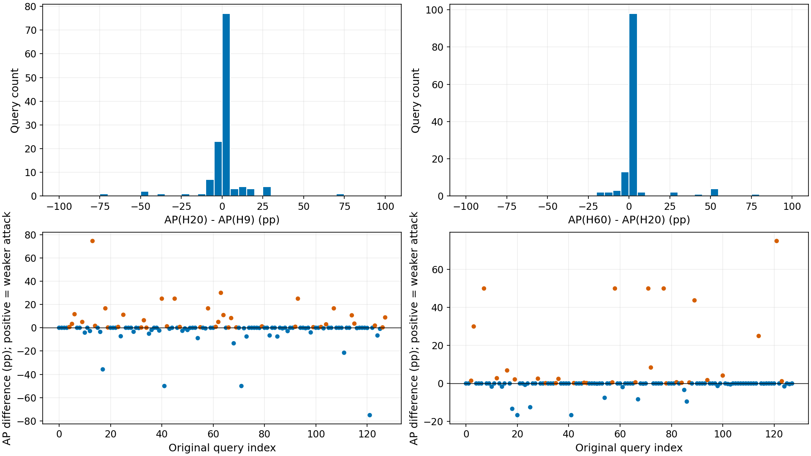
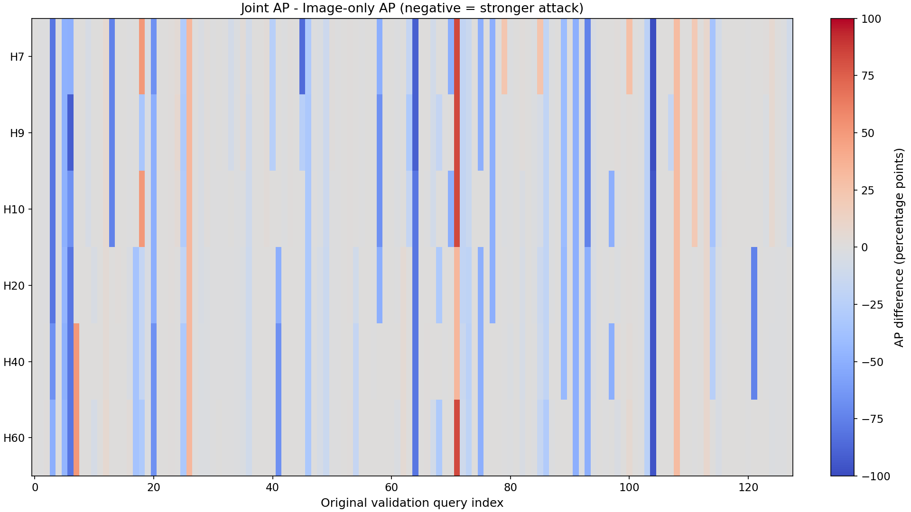
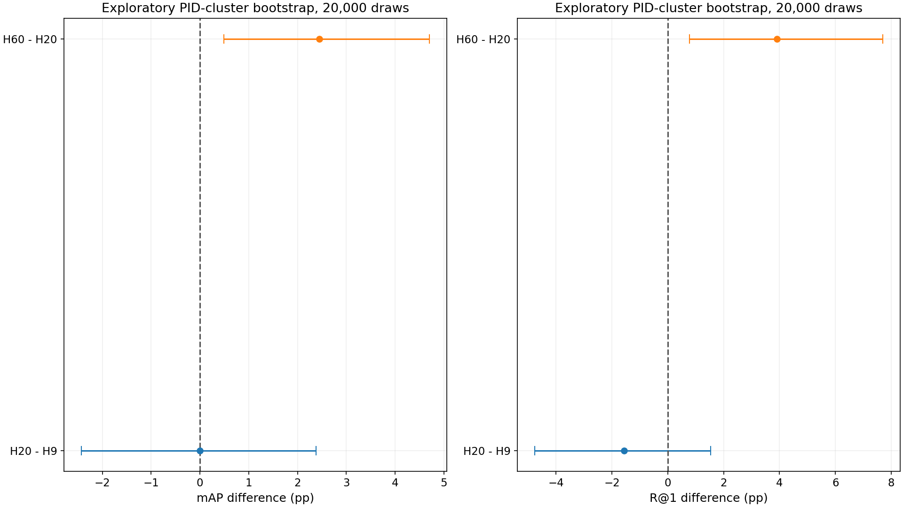

## 6. 字符策略究竟发生了什么

### 6.1 更少编辑主要是位置NOOP，不是大量提前STOP

| H候选 | 总编辑/128 | 平均K | 平均实际编辑 | 0编辑数 | 1编辑数 | 2编辑数 | ≥3编辑数 | 位置NOOP/位置决策 | STOP Rollout |
| --- | --- | --- | --- | --- | --- | --- | --- | --- | --- |
| 7 | 275 | 2.148 | 2.148 | 1 | 6 | 96 | 25 | 0/275 | 0 |
| 9 | 278 | 2.172 | 2.172 | 1 | 6 | 92 | 29 | 0/278 | 0 |
| 10 | 261 | 2.039 | 2.039 | 1 | 6 | 108 | 13 | 0/261 | 0 |
| 20 | 243 | 2.234 | 1.898 | 5 | 28 | 73 | 22 | 43/286 | 0 |
| 30 | 222 | 2.102 | 1.734 | 5 | 38 | 72 | 13 | 46/268 | 1 |
| 40 | 237 | 2.195 | 1.852 | 5 | 38 | 58 | 27 | 43/280 | 1 |
| 50 | 236 | 2.094 | 1.844 | 4 | 29 | 81 | 14 | 31/267 | 1 |
| 60 | 238 | 2.180 | 1.859 | 6 | 31 | 71 | 20 | 38/276 | 1 |


H9总预算278且全用；H20预算286、实际243，H60预算279、实际238。
平均K并没有相对H9下降，主要是选中属性后允许“不改此属性”的位置NOOP。
H20/H60总NOOP为5/6条，均包含1条固定资格NOOP；不能全算为学到的STOP。
H20没有STOP、H60仅1条。后期实际编辑并非单调下降，H30为222、H40又为237、H60为238。

训练Greedy NOOP在E20和E60均22/2037≈1.08%；若把11条固定跳过也计入全部Visit，则为33/2048≈1.61%。
Train STOP比例0.49%左右（E60），不足以支持“大量提前STOP”。
低编辑数与Joint弱化可同时出现，但上面逐Query证明二者不是单一对应。

每个Validation候选有相同612个Canonical Span，来自同一前端、同一128 Caption；
没有因为攻击失败改变样本集或属性提取器。平均有效属性数4.78125，K预算与使用次数分别统计，
不存在把6156 Query误当Gallery或换一套分辨率/Tokenizer的情况。

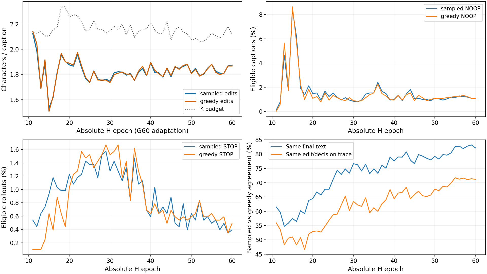
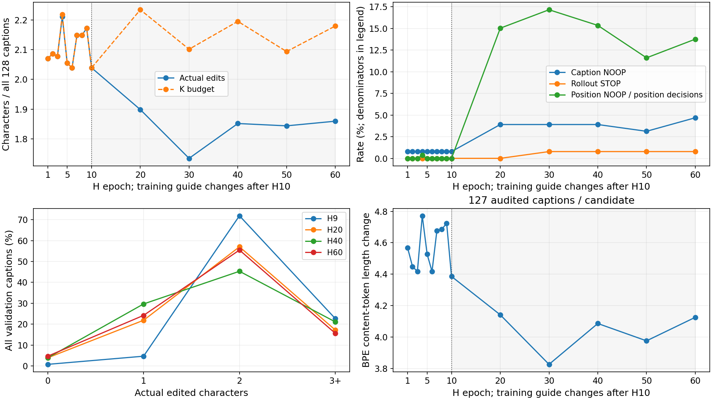

### 6.2 属性与替换字符分布

以下标签直接来自真实semantic_axis/region，不是按词义重新猜类别。占比分母为实际编辑次数。

| 原始semantic_axis/region | E11 Greedy编辑占比 % | E20占比 % | E60占比 % |
| --- | --- | --- | --- |
| gender/person | 44.17 | 31.06 | 23.17 |
| color/upper | 9.10 | 18.30 | 20.85 |
| color/lower | 2.20 | 12.03 | 18.06 |
| garment_type/upper | 10.86 | 4.05 | 6.05 |
| garment_type/lower | 2.98 | 1.59 | 2.60 |
| backpack/carried | 4.72 | 6.83 | 6.84 |
| bag/carried | 4.86 | 6.19 | 4.05 |
| hair_length/head | 5.98 | 5.12 | 4.15 |


E11性别标签约44.17%，E60约23.17%；上下装颜色合计由约11.29%升至38.92%。
这是明确的选择分布变化，不足以证明颜色选择导致泛化失败；没有针对其他属性强制替换的反事实比较。

| 原→新Unicode码位 | E11占比 % | E20占比 % | E60占比 % |
| --- | --- | --- | --- |
| U+0061→U+0430 | 34.41 | 37.60 | 39.02 |
| U+0065→U+0435 | 20.66 | 22.56 | 28.82 |
| U+006F→U+043E | 34.73 | 31.65 | 22.17 |
| U+0075→U+03C5 | 3.28 | 3.43 | 5.89 |
| U+0069→U+0456 | 4.88 | 2.52 | 2.00 |


E60的a→а、e→е、o→о合计约90.01%，E11约89.81%，没有证据表明后期才突然集中到这三种字符。
构成发生变化（a/e上升、o下降），不等于总集中度持续增加。
按源码白名单，a/e只有一个合法同形字候选；二者约占E60编辑67.84%，这些位置的Replacement选择本身没有多候选分辨空间，
但属性/字符位置仍可选择，不能由此推断整个策略已确定。

所有实际非NOOP都在既有审计中满足合法Span、每属性/共享词最多一次、Unicode白名单及无新增截断；
本轮再次回放原字符/码位/Span到最终字符串并统计。
127条可攻击Validation的Tokenizer记录均保留；H20/H60实际编辑123/122条，均token改变，未新增截断。
Token长度总增加/编辑数：H9约2.158，
H20约2.165，
H60约2.202。
没有“每次编辑造成的Token长度变化持续变小”的证据；
Token改变或变长也不能直接代表嵌入更远/攻击更强。本轮没有重新编码来验证这种因果。

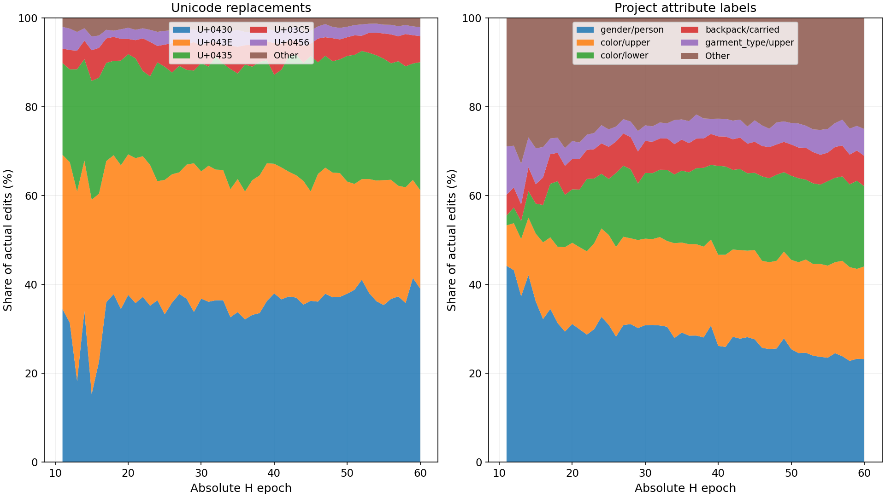

## 7. 为什么Text-only较弱，但Joint增量仍较大

H20在Clean图库的mAP下降只有0.716141pp，
在G60图库额外下降8.380978pp。
同一个文本扰动处在不同图像评分结构中，排名效果可以不同；这不是必须让Text-only最强的训练目标。

直接的分数证据：H20 Text-only正负Margin中位数0.176791，
Joint Margin中位数-0.062370。
G60 Image-only原本正确的51条Query，其Margin中位数0.077979，
其中3条低于0.01。说明图库攻击后存在较脆弱的排序边界，但不能概括成全部正确Query都只差极小分数。
语义看似类似的字符替换可能改变正负样本相对分数，图像已经受攻击时更容易造成额外排名变化；
这是受数据支持的解释，不证明H显式学会了“互补”或某种唯一机制。

H9 Text-only mAP95.9375、H20 99.283859，独立文本效果差3.346359pp，
Joint却近似持平。这直接否定“Text-only越强则Joint必然越强”的排序等价假设。
但不能据此把128小图库的Text-only数值与正式Full的H7数值相减作为提升/退化。

## 8. Reward与排名差距：同一个Validation上也能观察到

下表只使用已有Image-only/Joint矩阵按同一R_sim+R_rank数学定义派生诊断，
不送回训练或H策略。分母128；负池128而非Train2048，不能与在线Train均值直接作泛化误差相减。
paired分数、Margin差均来自FP32；汇总按Python/NumPy浮点执行，微小规约差异见方法说明。

| 候选 | 派生R_sim均值 | 派生R_rank均值 | 派生R_total均值 | Joint mAP | R>0但AP上升Query数 | R<0但AP下降Query数 |
| --- | --- | --- | --- | --- | --- | --- |
| H9 | 0.018386 | 0.021339 | 0.039725 | 40.425480 | 6 | 20 |
| H20 | 0.018998 | 0.021005 | 0.040003 | 40.427635 | 4 | 13 |
| H40 | 0.020639 | 0.023413 | 0.044051 | 41.223633 | 6 | 12 |
| H60 | 0.017453 | 0.017429 | 0.034882 | 42.874081 | 7 | 16 |


H40的派生R_sim、R_rank和R_total都高于H20，但Joint mAP反而高约0.796pp。
H20有4条“正奖励但AP升高”的Query及13条“负奖励但AP下降”的Query；
H60对应7/16条。这些是**代理奖励并不等价AP**的直接数据证据，
而不只是“Train与Validation样本不同”的笼统解释。

E20→E60 Train Sampled奖励提高，但Joint mAP上升2.446445pp。
仅五个新节点上，在线Reward与Joint mAP的Pearson为0.865
（mAP越高攻击越弱），Spearman约0.800；这是n=5、同轨迹、事后描述，不能据此推断因果或泛化规律。

训练Greedy synergy均值E20为−0.022062、E60为−0.016649，变得较不负但Joint更弱；
诊断量本身不应被当作优化目标或成功判据。若未来要引入交互奖励，需独立授权和控制，见research_next_steps.md。

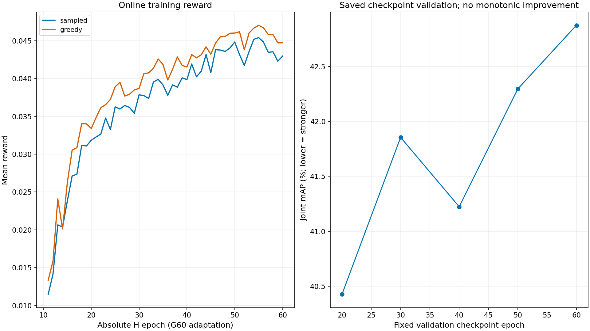

## 9. 对“为何H20以后没有继续改善”的证据分级

| 假设 | 直接证据/机制 | 评估 |
| --- | --- | --- |
| A. SCST有效信号变弱 | E20零梯度64.46%→E60 82.18%；各50轮同文本比例等于零梯度比例。 | 支持信号变稀疏；不支持所有非零梯度趋零：条件非零梯度均值0.995→1.827，全部合法Adam步仍改变H。 |
| B. Sampled与Greedy趋同 | 相同文本64.46%→82.18%，完全相同编辑/决策轨迹52.92%→71.18%；Advantage标准差0.04116→0.02508。 | 支持输出趋同；不支持100%确定或已证明模式坍塌。平均Reward差未单调缩为0。 |
| C. 字符策略更保守 | H9/H20/H60验证编辑278/243/238；位置NOOP 0/43/38；总NOOP 1/5/6。 | 相对历史H9部分支持，但H20→H60不单调；STOP仅0/0/1次，反对大量提前STOP的说法。 |
| D. Reward与Joint mAP目标不一致 | 同一128图库中H40派生R=0.044051>H20 0.040003，但Joint mAP41.223633>40.427635；存在正Reward且AP升高的Query。 | 直接支持代理目标非等价；不证明它是全部后期退化的唯一原因。 |
| E. 适应Train但不能稳定泛化 | E20→60 Train Sampled R 0.031844→0.042965，Validation Joint mAP40.427635→42.874081。 | 支持训练与验证趋势分离；证据不足以把原因命名为G60特有过拟合。 |
| F. 字符空间存在能力上限 | 平均K约2，合法跨度/替换白名单固定；E60 a/e两种唯一候选编辑合计约67.84%。 | 限制存在是事实，但没有穷举最优/更丰富空间对照，不能证明已触顶。 |
| G. 单seed、小Validation与选择偏差 | 128 Query/121 PID；H20−H9 mAP CI跨0；H60−H20探索性CI不跨0，但H20经过同集选优。 | 支持对小差异保持谨慎；不能把所有变化一概归为噪声，也不能宣称独立显著。 |


**事实**：训练奖励/动作/梯度和逐Query变化如上述；H20不是后续每一轮的观测最低点，只是五个预设Validation节点中的最低。
**合理解释**：奖励代理差距、输出趋同与小集合中脆弱排序共同限制了继续延长训练的可见收益。
**尚未证实**：哪一个是主因、G60是否导致过拟合、字符空间是否到上限，以及新交互奖励能否改善。
因此当前最准确的回答不是“已证明过拟合”，而是“更长适配训练没有在这条轨迹的预设内部Validation点持续改善Joint”。

完整假设机制、支持/反对及新实验需求见[hypothesis_assessment.md](hypothesis_assessment.md)。

## 10. G与H的联系，以及尚未实现的交互

G-v2是ImageOnlyGenerator：推理只有G(I)，没有FiLM或文本属性输入。
训练由Caption提取属性、Dynamic Top-K/JVP方向与整句z_t提供监督；
单样本逐属性K次Adam更新，下一轮输入上一轮detach图，最后从原图再做一次联合更新。
Global最小化图像特征与z_t的正dot，Local使用当前属性JVP，Retain惩罚上一属性分数回升；
最后Joint步用聚合v_local。这里的G训练“Joint步”是原图联合监督，不是G/H端到端联合训练。

H通过冻结G的Adv Gallery评分学习Caption-only字符策略，因此已有图像攻击感知的条件奖励。
当前联系为：
Caption属性→G训练监督；冻结G60图像特征→H训练奖励；最终固定G(I)和H(T)在检索输入层组合。
没有H→G的参数训练反馈，没有共享可微图文攻击生成图，没有两生成器共同优化的交互目标。
所以“有条件引导/检索层联合收益”成立，“端到端双模态联合训练”不成立。
本轮没有新核对MSI-Attack论文定义，不将当前机制与其等同。

G10固定图库时H7为历史最低67.493835%；相同H1–10换成G60图库时H9最低40.425480%。
排序确实变化，但G条件也改变了检索问题的基线和难度；
不能拿这两个绝对mAP差直接定义H适配收益或证明某模块因果。

## 11. 历史三Victim Full仅作背景

下表H始终为历史H7，不是本次H60。固定3074 Gallery/6156 Query、Raw Clean及各Victim原生评分。

| Victim | G Epoch | Image-only mAP | H7 Joint mAP | H7额外下降 pp |
| --- | --- | --- | --- | --- |
| IRRA | 10 | 32.2823 | 23.5532 | 8.7291 |
| IRRA | 60 | 17.5075 | 13.0795 | 4.4280 |
| RaSa | 10 | 35.0470 | 17.2026 | 17.8443 |
| RaSa | 60 | 26.4665 | 12.5701 | 13.8964 |
| APTM | 10 | 39.6620 | 30.4903 | 9.1717 |
| APTM | 60 | 32.1108 | 23.7426 | 8.3682 |

G增加训练轮数后的三模型Image-only/固定H7 Joint总体更强，是此前正式Full的结果；
它不能证明新H60也会在三模型Full更强，本轮没有这些新结果。
Full的Clean/H7 Text-only、全部R@1/5/10/mAP及原始来源在historical_full_context.csv中保留。
IRRA为同来源模型，RaSa/APTM为冻结IRRA训练产物的迁移；
128内部Validation与Full绝对mAP不可直接比较，Raw Clean也不能替换成其他Baseline的Matched Clean。

## 12. 下一阶段决策

**优先一个实验：A，固定G10奖励图库，按相同H10父状态、训练长度、数据顺序和预算续训至60的匹配控制。**
理由是当前同时延长训练并切换图像奖励条件，尚不能区分两者。
不要先修改Loss再解释这条轨迹；新的奖励/交互设计应建立在控制与独立确认之上。
E（新PID确认及多seed）是可靠报告小差异的配套需求。
B/C/D可作为后续独立研究，不能承诺提升，也不能把常见代理奖励替换直接当作已成立创新。

[具体方案、资源、创新定位与失败风险](research_next_steps.md)。

## 13. 资源、缺失项与可复现边界


训练会话attempt_elapsed_seconds=7142.935593，
训练目录计时elapsed_seconds=7127.092438（约1.980小时）。
逐Step记录合计5734.549秒；Checkpoint、Validation及部分日志I/O不计入Step计时，
不能把两者差额全部归因于某一个因素。
GPU allocated/reserved峰值约761.311/824MiB；训练进程Peak RSS约2301.5MiB。
共享GPU，未终止其他进程，不把时间当独占吞吐。

训练IRRA加载1次，文本调用102465次、样本306165条；
其中SCST合法更新需要101850×3=305550条，剩余615条对应五次Validation改变的Caption编码。
本轮动作统计的五候选非NOOP总数同为615，来源计数一致。
训练期间G/图像新前向0，缓存准备原2048图属于之前独立阶段，不重新计算。

明确缺失/限制：

- H1–H10历史Text-only完整分数矩阵未保存，只有审计通过的汇总、文本特征与动作；本轮不从汇总mAP推导逐Query Text-only。
- 历史G60+H9 Joint完整矩阵可用，所需核心逐Query对比不缺失。
- 没有动作概率/策略熵，也没有针对候选空间的穷举最优性证明。
- 单训练轨迹、单seed、重复128 Validation，没有新的独立确认或G10延长训练控制。
- 新H20–60没有官方Test或RaSa/APTM结果；历史Full全是固定H7，不混入当前候选选择。
- 人类语义可读性没有人工实验；合法同形字不自动等于语义/视觉无损。
- 原报告失败目录原样保留；本轮新目录与之不同，没有修复或覆盖hashlib.file_digest原件。

新增统计CPU单元测试10项PASS，覆盖多正例AP、原生tie排序、PID Bootstrap、动作记录与来源篡改拒绝。
附加Full标量读取初次遇到“长方法名/短模式名”字段差异而停止，随后仅修独立分析读取映射；
原实验无错误、未重跑模型，初次分析日志保留。最终读取与全部原始Full摘要原精度一致。
这是本轮分析器格式兼容，不是训练/评测重试或修改结果。

所有CPU分析代码位于src/tbps/ablations/hv1_g60_posthoc*.py及plot_hv1_g60_posthoc.py，
源码SHA、输入清单与运行环境见SOURCE_EVIDENCE.json和INPUT_MANIFEST.json。
完整输入5.094GB只读核验不等于全部151378历史文件重新算SHA；后者是元数据保护循环，二者明确区分。

## 附表A：全部50轮在线统计

| Epoch | Sampled R | Greedy R | Loss均值 | 零梯度 % | Greedy平均编辑 | Greedy NOOP % | Greedy STOP % |
| --- | --- | --- | --- | --- | --- | --- | --- |
| 11 | 0.011486 | 0.013344 | -0.008934 | 61.51 | 2.143 | 0.00 | 0.10 |
| 12 | 0.014151 | 0.015876 | -0.006939 | 59.70 | 2.043 | 0.59 | 0.10 |
| 13 | 0.020656 | 0.024088 | -0.009146 | 54.74 | 1.687 | 5.65 | 0.10 |
| 14 | 0.020361 | 0.020118 | 0.001823 | 55.82 | 1.917 | 1.72 | 0.25 |
| 15 | 0.023818 | 0.026266 | -0.009707 | 57.44 | 1.507 | 8.64 | 0.64 |
| 16 | 0.027112 | 0.030531 | -0.012145 | 56.46 | 1.625 | 5.69 | 0.39 |
| 17 | 0.027361 | 0.030871 | -0.013986 | 60.19 | 1.810 | 2.21 | 0.88 |
| 18 | 0.031154 | 0.034038 | -0.010604 | 59.16 | 1.966 | 0.98 | 0.64 |
| 19 | 0.031092 | 0.034011 | -0.011142 | 63.77 | 1.900 | 1.82 | 0.44 |
| 20 | 0.031844 | 0.033400 | -0.006523 | 64.46 | 1.889 | 1.08 | 1.03 |
| 21 | 0.032272 | 0.034837 | -0.009477 | 66.76 | 1.874 | 1.23 | 1.23 |
| 22 | 0.032670 | 0.036155 | -0.012929 | 65.68 | 1.974 | 0.79 | 1.28 |
| 23 | 0.034784 | 0.036554 | -0.006659 | 67.70 | 1.868 | 1.52 | 1.57 |
| 24 | 0.033268 | 0.037241 | -0.012630 | 67.70 | 1.775 | 0.93 | 1.47 |
| 25 | 0.036254 | 0.038918 | -0.007677 | 71.13 | 1.739 | 1.33 | 1.52 |
| 26 | 0.035973 | 0.039506 | -0.012616 | 74.32 | 1.825 | 1.13 | 1.33 |
| 27 | 0.036439 | 0.037685 | -0.006264 | 72.85 | 1.756 | 0.98 | 1.42 |
| 28 | 0.036185 | 0.037933 | -0.005735 | 74.82 | 1.756 | 0.88 | 1.52 |
| 29 | 0.035404 | 0.038500 | -0.009869 | 73.34 | 1.756 | 1.13 | 1.67 |
| 30 | 0.037856 | 0.038705 | -0.004716 | 76.63 | 1.736 | 0.88 | 1.52 |
| 31 | 0.037746 | 0.040656 | -0.006054 | 76.29 | 1.798 | 0.83 | 1.57 |
| 32 | 0.037372 | 0.040753 | -0.011614 | 74.08 | 1.810 | 0.88 | 1.67 |
| 33 | 0.039543 | 0.041359 | -0.006088 | 76.44 | 1.819 | 1.13 | 1.18 |
| 34 | 0.039898 | 0.042592 | -0.009008 | 73.15 | 1.802 | 1.37 | 1.42 |
| 35 | 0.039152 | 0.041861 | -0.007233 | 74.82 | 1.803 | 1.52 | 0.83 |
| 36 | 0.037777 | 0.039815 | -0.006053 | 73.29 | 1.754 | 2.26 | 1.62 |
| 37 | 0.039167 | 0.041228 | -0.007057 | 76.09 | 1.825 | 1.47 | 1.28 |
| 38 | 0.038857 | 0.042861 | -0.014300 | 75.06 | 1.865 | 1.28 | 1.08 |
| 39 | 0.040098 | 0.041740 | -0.005457 | 78.94 | 1.793 | 0.98 | 0.69 |
| 40 | 0.039858 | 0.041531 | -0.004853 | 77.66 | 1.894 | 0.93 | 0.64 |
| 41 | 0.041930 | 0.043166 | -0.005781 | 78.99 | 1.833 | 1.33 | 0.79 |
| 42 | 0.040234 | 0.042741 | -0.007747 | 78.94 | 1.805 | 0.93 | 0.64 |
| 43 | 0.040976 | 0.043147 | -0.006531 | 80.76 | 1.783 | 1.37 | 0.69 |
| 44 | 0.043179 | 0.044203 | -0.004521 | 77.91 | 1.850 | 1.52 | 0.49 |
| 45 | 0.040780 | 0.043221 | -0.005737 | 76.63 | 1.791 | 0.88 | 0.69 |
| 46 | 0.043822 | 0.044718 | -0.003747 | 79.82 | 1.863 | 1.33 | 0.59 |
| 47 | 0.043767 | 0.045532 | -0.005063 | 79.28 | 1.840 | 1.13 | 0.54 |
| 48 | 0.043592 | 0.045576 | -0.006057 | 78.55 | 1.871 | 0.88 | 0.59 |
| 49 | 0.044050 | 0.045990 | -0.007470 | 77.96 | 1.880 | 0.98 | 0.54 |
| 50 | 0.044841 | 0.046019 | -0.005867 | 79.19 | 1.806 | 1.08 | 0.59 |
| 51 | 0.043164 | 0.046192 | -0.009509 | 78.25 | 1.840 | 1.08 | 0.64 |
| 52 | 0.041733 | 0.043801 | -0.004332 | 79.82 | 1.787 | 1.08 | 0.83 |
| 53 | 0.043578 | 0.046038 | -0.008301 | 79.63 | 1.806 | 1.13 | 0.59 |
| 54 | 0.045193 | 0.046670 | -0.005644 | 80.41 | 1.845 | 1.18 | 0.59 |
| 55 | 0.045412 | 0.047041 | -0.005931 | 82.62 | 1.880 | 1.23 | 0.64 |
| 56 | 0.044840 | 0.046723 | -0.005374 | 82.77 | 1.816 | 1.23 | 0.54 |
| 57 | 0.043475 | 0.045834 | -0.007385 | 81.93 | 1.798 | 1.33 | 0.54 |
| 58 | 0.043540 | 0.045825 | -0.006446 | 82.77 | 1.811 | 1.23 | 0.59 |
| 59 | 0.042295 | 0.044726 | -0.007294 | 83.21 | 1.866 | 1.08 | 0.34 |
| 60 | 0.042965 | 0.044733 | -0.004949 | 82.18 | 1.867 | 1.08 | 0.49 |


## 附表B：输出索引

| 文件 | 内容 |
| --- | --- |
| training_epoch_statistics.csv | 新50轮全部数值与分布摘要，原始精度 |
| historical_training_epoch_statistics.csv | H1–10同口径流式解析 |
| training_metric_distributions.csv | 全60轮各指标分布分位数、正负零计数 |
| training_resource_epoch_statistics.csv | 新50轮逐Step时间与GPU峰值 |
| training_phase_statistics.csv | 每10轮描述性聚合 |
| validation_comparison.csv | 固定G60下全部15候选主表原精度 |
| validation_metrics_raw.csv | Text-only/Joint四指标原精度 |
| per_query_analysis.csv | 2688条逐Query AP/排名/相似度/Margin与派生诊断 |
| per_query_comparisons.csv | 5对候选逐Query变化 |
| validation_reward_diagnostics.csv | 同Validation代理奖励与AP不一致性统计 |
| action_distribution.csv | 类型、字符、预算/编辑数与Token变化直方图 |
| action_epoch_statistics.csv | 训练Sampled/Greedy及Validation的STOP/NOOP/编辑统计 |
| checkpoint_inventory.csv | 历史81+新增400版本元数据/SHA，不含权重 |
| historical_full_context.csv | 历史三模型Full背景及控制组，未重算 |
| hypothesis_assessment.md | A–G机制、事实、判断与待验证 |
| research_next_steps.md | A–E方案、成本、风险与优先级 |
| code_evidence.csv | 实际源码函数、行号、SHA与作用 |
| figures/ | 12张PNG及12张SVG，真实节点无虚构插值 |

## 附录C：代表性Query文本与Unicode动作

以下按Rank-1翻转及绝对AP变化选取，只作描述，不据此选样或修改攻击策略。
完整动作包括原Span、码位、位置与Tokenizer记录保留在统计JSON的examples字段。

### H9_vs_H20 / Query 13 / cuhk:9025:0

原文："A man wearing a tight, red and white vest, a pair of blue jean shorts and a pair of white shoes."

H9："A mаn wearing a tight, red and white vеst, a pair of blue jean shorts and a pair of white shoes."

动作：gender/person U+0061→U+0430 @3；garment_type/upper U+0065→U+0435 @38。

H20："A man wearing a tight, red and white vest, a pair of blυe jean shorts and a pair of white shoes."

动作：color/lower U+0075→U+03C5 @55。

AP 0.088346→0.833333，最佳正例排名14→1；分数/Margin见逐Query CSV。

### H9_vs_H20 / Query 41 / cuhk:23991:0

原文："He has short   black hair  and is carrying a   black  and  grey back pack . He is  also  wearing a  grey jacket ."

H9："Hе has shоrt   black hair  and is carrying a   black  and  grey back pack . He is  also  wearing a  grey jacket ."

动作：gender/person U+0065→U+0435 @1；hair_length/head U+006F→U+043E @9。

H20："Hе has short   black hair  and is carrying a   black  and  grey back pack . He is  also  wearing a  grey jackеt ."

动作：gender/person U+0065→U+0435 @1；garment_type/upper U+0065→U+0435 @109。

AP 1.000000→0.500000，最佳正例排名1→2；分数/Margin见逐Query CSV。

### H9_vs_H20 / Query 71 / cuhk:28682:0

原文："A person wearing a baggy blue long-sleeved shirt, dark pants, and white tennis shoes is walking away from the viewer. The person has grey hair and is looking to their right."

H9："A person wearing a baggy blυe lоng-sleeved shirt, dark pants, and white tennis shoes is walking away from the viewer. The person has grey hair and is looking to their right."

动作：sleeve_length/upper U+006F→U+043E @31；color/upper U+0075→U+03C5 @27。

H20："A person wearing a baggy bluе lоng-sleeved shirt, dark pants, and white tennis shoes is walking away from the viewer. The person has grey hair and is looking to their right."

动作：color/upper U+0065→U+0435 @28；sleeve_length/upper U+006F→U+043E @31。

AP 1.000000→0.500000，最佳正例排名1→2；分数/Margin见逐Query CSV。

### H9_vs_H20 / Query 121 / cuhk:31297:0

原文："A young lady walking with red shoes, jean capris and a pink blouse with short hair. "

H9："A young lаdy walking with red shoes, jean capris and a pink blouse with shоrt hair. "

动作：gender/person U+0061→U+0430 @9；hair_length/head U+006F→U+043E @74。

H20："A young lаdy walking with red shoes, jean capris and a pіnk blouse with short hair. "

动作：gender/person U+0061→U+0430 @9；color/upper U+0069→U+0456 @56。

AP 1.000000→0.250000，最佳正例排名1→4；分数/Margin见逐Query CSV。

### H20_vs_H60 / Query 7 / cuhk:29597:0

原文："A man wearing a black shirt, a pair of blue pants, a pair of blue and pink shoes and a pair of glasses."

H20："A man wearing a blаck shirt, a pair of blue pants, a pair of blue and pink shoes and a pair of glasses."

动作：color/upper U+0061→U+0430 @18。

H60："A man wearing a blаck shirt, a pair of blυe pants, a pair of blue and pink shoes and a pair of glasses."

动作：color/upper U+0061→U+0430 @18；color/lower U+0075→U+03C5 @41。

AP 0.500000→1.000000，最佳正例排名2→1；分数/Margin见逐Query CSV。

### H20_vs_H60 / Query 58 / cuhk:3731:0

原文："This person is wearing a brown boat, dark pants and tennis shoes.  They have a black and white backpack with straps over both shoulders.  They have short black hair.  "

H20："This person is wearing a brown boat, dark pants and tennis shoes.  They have a black and white bаckpack with straps over both shoulders.  They have shоrt black hair.  "

动作：backpack/carried U+0061→U+0430 @96；hair_length/head U+006F→U+043E @150。

H60："This person is wearing a brown boat, dark pаnts and tennis shoes.  They have a black and white bаckpack with straps over both shoulders.  They have short black hair.  "

动作：backpack/carried U+0061→U+0430 @96；garment_type/lower U+0061→U+0430 @43。

AP 0.500000→1.000000，最佳正例排名2→1；分数/Margin见逐Query CSV。

### H20_vs_H60 / Query 71 / cuhk:28682:0

原文："A person wearing a baggy blue long-sleeved shirt, dark pants, and white tennis shoes is walking away from the viewer. The person has grey hair and is looking to their right."

H20："A person wearing a baggy bluе lоng-sleeved shirt, dark pants, and white tennis shoes is walking away from the viewer. The person has grey hair and is looking to their right."

动作：color/upper U+0065→U+0435 @28；sleeve_length/upper U+006F→U+043E @31。

H60："A person wearing a baggy blυe lоng-sleeved shirt, dark pants, and white tennis shoes is walking away from the viewer. The person has grey hair and is looking to their right."

动作：color/upper U+0075→U+03C5 @27；sleeve_length/upper U+006F→U+043E @31。

AP 0.500000→1.000000，最佳正例排名2→1；分数/Margin见逐Query CSV。


## 交付补充

[全部12图PNG/SVG索引](FIGURES.md)；[六个固定节点的Checkpoint来源](fixed_checkpoint_sources.csv)。

训练E11–20的Greedy NOOP十轮均值约2.84%，E51–60约1.16%，
平均编辑数约1.849→1.832；这不支持“后期NOOP持续增多”的强断言。
相对历史H9存在位置NOOP和较少编辑的变化，但H20之后的更弱Joint不能简单归因于不断提前STOP。
图中显示的是事件频率，绝不是未保存的策略熵。

Validation派生R_total在validation_reward_diagnostics.csv中使用Python浮点相加，
更贴近RewardEvaluator将两个FP32差值转成Python float后求和的语义；
per_query_analysis.csv的R_total_posthoc保留初始FP32相加诊断值，可能有约1e−8尾差。
两者都只是本轮只读派生量，原始训练Reward和原实验指标完全没有修改。

Source、原始控制FAIL和报告残留均保持；本交付仅表示CPU分析通过，不将旧监督器重标为SUCCESS。
